# Modelo de datos de VES

Este documento describe los contratos de datos expuestos y utilizados por `Bccr.Supen.Ves.Api`, a partir de las clases de `Bccr.Supen.Ves.Abstracciones.Contenedores`, y el esquema y contrato SQL reportado para documentos STI en [`SCHEMA.md`](../VES/Bccr.Supen.Ves.Mapi/Documentacion/SCHEMA.md). Los contratos son modelos de transferencia entre la API y sus servicios; salvo las tablas de documentos STI detalladas más adelante, las relaciones del diagrama son referencias conceptuales basadas en códigos y propiedades compartidos, no un esquema ORM ni garantías de integridad referencial.

## Model Descriptions

### 1. ArchivoNuevoVes y STIArchivoVes
Representan información de archivos que se registran o tramitan en VES.

**Fields (`ArchivoNuevoVes`):**
- `Usuario`: código de usuario asociado
- `Nombre`: nombre del archivo
- `CodigoTipoArchivo`: código del tipo de archivo
- `CodigoFondo`: código del fondo
- `Estado`: estado del registro
- `UsuarioRegistra`: usuario que registra
- `FechaRegistro`: fecha del registro

**Fields (`STIArchivoVes`):**
- `Nombre`: nombre del archivo
- `CodigoTipoArchivo`: código del tipo de archivo
- `CodigoFondo`: código de fondo opcional (`int?`)
- `CodigoEntidad`: código de entidad
- `FechaDatos`: fecha de los datos
- `Usuario`: código de usuario

**Validation Rules:**
- Las clases declaran los tipos de sus propiedades, pero no especifican reglas de validación adicionales.

**Relationships:**
- Los códigos de usuario, tipo de archivo, fondo y entidad son referencias por valor; las clases no declaran propiedades de navegación.

### 2. ArchivoRecibido, ArchivoEnviado, ArchivoPorEnviar y ArchivoEliminado
Representan archivos según su etapa o condición en los procesos de recepción, envío, programación y eliminación.

**Fields (`ArchivoRecibido`):**
- `Entidad`: entidad relacionada
- `Id`: identificador del registro
- `TipoDeArchivo`: tipo de archivo
- `Fondo`: fondo relacionado
- `FechaEnvio`: fecha de envío
- `FechaDatos`: fecha de los datos
- `Estado`: estado del archivo
- `Usuario`: usuario relacionado
- `Solicitud`: número de solicitud

**Fields (`ArchivoEnviado`):**
- `Id`: identificador del registro
- `TipoDeArchivo`: tipo de archivo
- `Fondo`: fondo relacionado
- `FechaEnvio`: fecha de envío
- `FechaDatos`: fecha de los datos
- `Estado`: estado del archivo
- `Usuario`: usuario relacionado
- `Solicitud`: número de solicitud

**Fields (`ArchivoPorEnviar` y `ArchivoEliminado`):**
- `Id`: identificador del registro
- `TipoDeArchivo`: tipo de archivo
- `Fondo`: fondo relacionado
- `FechaEjecucion`: fecha de ejecución
- `FechaDatos`: fecha de los datos
- `Estado`: estado del archivo
- `Usuario`: usuario relacionado

**Validation Rules:**
- Los contratos no declaran restricciones de longitud, obligatoriedad, unicidad ni validaciones de fecha.

**Relationships:**
- `TipoDeArchivo`, `Fondo`, `Entidad`, `Usuario` y `Solicitud` son datos de referencia del archivo; no se definen claves foráneas en estos contratos.

### 3. TiposArchivo
Describe la configuración de un tipo de archivo y los usuarios asociados a este.

**Fields:**
- `CodigoTipoArchivo`: código del tipo de archivo
- `Nombre`: nombre del tipo de archivo
- `RequiereFondo`: indicador de si requiere fondo
- `Periodicidad`: periodicidad del tipo de archivo
- `Estado`: estado del tipo de archivo
- `Abreviatura`: abreviatura
- `FondoDefecto`: fondo por defecto
- `CodigoInterno`: código interno
- `ArchivoXSD`: referencia al esquema XSD
- `LaListaDeUsuarios`: lista de usuarios asociados

**Validation Rules:**
- No se declaran reglas de validación adicionales en el contrato.

**Relationships:**
- `LaListaDeUsuarios` representa una asociación con usuarios en la respuesta del contrato.
- `UsuarioTipoArchivo` permite representar la asociación por los códigos `CodigoUsuario` y `CodigoTipoArchivo`.

### 4. Usuario y UsuarioAutenticado
Representan la identidad del usuario y los datos de usuario autenticado utilizados por la API.

**Fields (`Usuario`):**
- `CodigoUsuario`: código del usuario (`decimal`)
- `Cedula`: identificación
- `Nombre1`: primer nombre
- `Apellido1`: primer apellido
- `Apellido2`: segundo apellido
- `AbreviaturaDeLaEntidadYNombreCompleto`: abreviatura de la entidad y nombre completo

**Fields (`UsuarioAutenticado`):**
- `CodigoUsuario`: código del usuario (`decimal`)
- `CodigoRol`: código del rol
- `CodigoEntidad`: código de la entidad
- `Directorio`: directorio asociado
- `Nombre`, `Nombre1`, `Apellido1`: nombre y datos personales
- `CodigoInterno`: código interno

**Validation Rules:**
- El contrato no declara restricciones de formato o unicidad.

**Relationships:**
- El usuario puede asociarse con tipos de archivo a través de `UsuarioTipoArchivo`.
- Los contratos de archivo incluyen códigos o valores de usuario, sin declarar una propiedad de navegación hacia `Usuario`.

### 5. UsuarioTipoArchivo
Representa la asociación entre un usuario y un tipo de archivo.

**Fields:**
- `CodigoUsuario`: código del usuario (`decimal`)
- `CodigoTipoArchivo`: código del tipo de archivo (`int`)

**Validation Rules:**
- No se declaran reglas adicionales en el contrato.

**Relationships:**
- Referencia conceptualmente a `Usuario` mediante `CodigoUsuario` y a `TiposArchivo` mediante `CodigoTipoArchivo`.

### 6. Entidad y Fondo
Representan entidades y fondos utilizados por los procesos de VES.

**Fields (`Entidad`):**
- `CodigoEntidad`: código de la entidad
- `Abreviatura`: abreviatura
- `Nombre`: nombre de la entidad
- `Estado`: estado de la entidad

**Fields (`Fondo`):**
- `CodigoFondo`: código del fondo
- `CodigoSupen`: código SUPEN
- `Nombre`: nombre del fondo
- `Ley`: ley asociada
- `CodigoMoneda`: código de moneda
- `CodigoRegimen`: código de régimen
- `Descripcion`: descripción

**Validation Rules:**
- Los contratos no especifican restricciones de obligatoriedad o formato.

**Relationships:**
- Los códigos de entidad y fondo son utilizados por contratos de archivos, operaciones y reportes.
- Estas referencias no establecen por sí solas una relación física ni una cardinalidad de base de datos.

### 7. OperacionSEC, ResumenOperacion, DetalleOperacionConSaldos y SaldoOperacion
Representan operaciones SEC, sus resúmenes, detalles y saldos.

**Fields (`OperacionSEC`):**
- `Lote`: identificador del lote opcional (`Int64?`)
- `EntidadDestino`: código de entidad destino opcional (`int?`)
- `AbreviaturaEntidad`: abreviatura de entidad
- `CodigoProceso`: código de proceso opcional (`int?`)
- `ESTCodigo`: código de estado
- `FechaCiclo`: fecha de ciclo opcional
- `TotalOperaciones`: total de operaciones
- `FechaGeneracionArchivo`: fecha de generación opcional
- `NumeroEnvio`: número de envío opcional (`Int64?`)
- `MotivoRechazo`: motivo de rechazo
- `Proceso` y `Estado`: descripción del proceso y estado
- `Total`, `CantidadOperaciones`, `CantidadRechazadas`, `CantidadPendientes`: contadores
- `TipoMovimiento`: tipo de movimiento

**Fields (`ResumenOperacion`):**
- `Lote`, `EntidadDestino` y `Proceso`: identificadores del lote, entidad destino y proceso
- `EST_Codigo`: código de estado
- `FechaCiclo`, `FechaGeneracionArchivo`: fechas del ciclo y generación
- `NumeroEnvio`: número de envío opcional
- `TotalOperaciones`: total de operaciones
- `FechaOficializacion`, `UsuarioOficializacion`: datos opcionales de oficialización
- `CantidadActualizacionesSaldo`, `UltimaFechaActualizacionesSaldo`, `UltimoUsuarioActualizacionesSaldo`: datos de actualizaciones de saldo
- `FechaRechazo`, `UsuarioRechazo`, `MotivoRechazo`: datos de rechazo
- `UsuarioRegistra`, `FechaRegistro`, `UsuarioModificacion`, `FechaModificacion`: datos de auditoría
- `Bitacora`: colección de eventos `BitacoraOperacion`

**Fields (`DetalleOperacionConSaldos`):**
- `OPE_Lote`, `OPE_EntidadDestino`: referencias al lote y entidad destino
- `TipoIdentificacion`, `Identificacion`: identificación
- `TipoFondo`, `CodigoFondo`: datos del fondo
- `EST_Codigo`: código de estado
- `Moneda`, `Monto`: moneda e importe
- `MotivoRechazo`: motivo de rechazo
- `NumeroContratoIndividual`, `IncentivoFiscal`, `TipoIdAfiliadoOrigen`, `IdAfiliadoOrigen`, `NumeroFormulario`: datos del detalle
- `Saldos`: colección de `SaldoOperacion`

**Fields (`SaldoOperacion`):**
- `DET_OPE_Lote`, `DET_OPE_EntidadDestino`: referencias al lote y entidad destino del detalle
- `NumeroPatrono`, `Monto`, `SubMonto1`, `MontoAcumulado`: datos de montos
- `FechaControl`, `TipoFecha`: fecha y tipo de fecha de control
- `NumeroContratoDesacumulacion`: número de contrato
- `TipoIdentificacionCausante`, `NumeroIdentificacionCausante`: identificación del causante
- `TipoBeneficiarioROP`: tipo de beneficiario
- `FechaRevisionPension`: fecha opcional de revisión

**Validation Rules:**
- Los contratos no definen reglas de negocio para estados, montos o fechas.

**Relationships:**
- `ResumenOperacion` contiene una colección de bitácora.
- `DetalleOperacionConSaldos` contiene una colección de saldos.
- Los identificadores de lote y entidad destino permiten relacionar conceptualmente los resúmenes y detalles; no se declaran claves foráneas.

### 8. Bitacora y Rastro
Representan información de seguimiento y auditoría de solicitudes y operaciones.

**Fields (`Bitacora`):**
- `Solicitud`: número de solicitud (`decimal`)
- `Reporte`, `Entidad`, `Fecha`, `Fondo`, `Usuario`, `Proceso`, `Ejecucion`, `Estado`: datos de contexto
- `Registros`: cantidad de registros (`decimal`)
- `Inicio`, `UltProceso`: datos temporales del proceso
- `Procesados`, `Errores`: contadores

**Fields (`Rastro`):**
- `Usuario`: usuario que ejecuta la acción
- `Proceso`: proceso relacionado
- `DireccionIp`: dirección IP

**Fields (`BitacoraOperacion`):**
- `Id`: identificador del evento (`long`)
- `CodigoEvento`: código del evento
- `FechaCiclo`, `FechaEvento`: fechas del ciclo y del evento
- `Lote`, `Entidad`, `TotalOperaciones`: referencias y total opcionales
- `Detalle`, `Usuario`, `Proceso`, `IP`: detalle y contexto del evento
- `CodigoInternoEntidad`, `AbreviaturaEntidad`: referencias descriptivas de la entidad

**Validation Rules:**
- Los contratos no especifican retención, formato o reglas de auditoría.

**Relationships:**
- `BitacoraOperacion` se expone como colección en `ResumenOperacion`.
- `Rastro` transporta datos de contexto de usuario, proceso e IP; no declara vínculos de persistencia.

### 9. Proceso, DiaNoHabil y ReglaCalendario
Representan procesos y datos de calendario utilizados en la ejecución de reglas y operaciones.

**Fields (`Proceso`):**
- `Id`: identificador del proceso
- `Nombre`: nombre del proceso
- `Codigo`: código del proceso (`char`)

**Fields (`DiaNoHabil`):**
- `CodigoProceso`: código del proceso
- `Fecha`: fecha no hábil
- `Descripcion`: descripción

**Fields (`ReglaCalendario`):**
- `Nombre`, `NombreProceso`, `Descripcion`, `Tipo`: identificación y descripción de la regla
- `CodigoProceso`: código del proceso
- `UsarTodos`: indicador
- `Dia`, `Mes`, `Anyo`: componentes de calendario

**Validation Rules:**
- No se especifican formatos ni reglas para los valores de calendario en estos contratos.

**Relationships:**
- `DiaNoHabil` y `ReglaCalendario` incluyen `CodigoProceso` como referencia a un proceso.

### 10. ParametroSEC, STIArchivo y ModeloValidacion
Incluyen parámetros SEC, metadatos de archivos procesados por STI y el resultado común de validación.

**Fields (`ParametroSEC`):**
- `Parametro`: nombre del parámetro
- `Valor`: valor del parámetro
- `EsPublico`: indicador (`char`)

**Fields (`STIArchivo`):**
- `FechaDatos`: fecha de los datos
- `Registros`: cantidad de registros (`decimal`)
- `Fondo`, `Tipo`, `Entidad`, `Archivo`: referencias y nombre del archivo
- `RequiereFecha`: indicador (`bool`)
- `RequiereFondo`: indicador (`char`)
- `NumeroSolicitud`: número de solicitud

**Fields (`ModeloValidacion`):**
- `EsValido`: resultado de validación (`bool`)
- `Mensaje`: mensaje asociado

**Validation Rules:**
- `ModeloValidacion` inicializa el resultado como válido; el constructor que recibe un mensaje lo inicializa como inválido.

**Relationships:**
- `STIArchivo` reúne información del archivo, entidad, tipo y fondo en un solo contrato.
- `ModeloValidacion` se utiliza como resultado de validación; no representa una entidad persistente.

### 11. ReporteErrorArchivo
Representa el reporte de errores asociado al procesamiento de un archivo.

**Fields:**
- `NombreArchivo`: nombre del archivo
- `ArchivoExcel`: referencia o nombre del archivo Excel
- `CodigoEntidad`: código de entidad
- `CodigoFondo`: código de fondo
- `FechaDeDatos`: fecha de los datos
- `CodigoInterno`: código interno
- `ModeloValidacion`: resultado de validación

**Validation Rules:**
- No se declaran restricciones adicionales en el contrato.

**Relationships:**
- Contiene un `ModeloValidacion` y códigos de referencia para entidad, fondo y código interno.

## Contratos de consulta de documentos STI

Los contratos de respuesta de API y los contratos de MAPI tienen nombres y
campos equivalentes, pero pertenecen a proyectos `Abstracciones` separados.
El modelo de acceso a datos de MAPI también proyecta únicamente los campos de
la consulta. Estos tipos de transferencia no representan el esquema SQL.

### `TipoDocumentoConsulta`

| Propiedad | Tipo C# | Descripción |
|---|---|---|
| `CodigoTipoDoc` | `int` | Código del tipo de documento. |
| `Nombre` | `string` | Nombre del tipo de documento. |

### `DocumentoConsulta`

| Propiedad | Tipo C# | Descripción |
|---|---|---|
| `Codigo` | `int` | Código del documento. |
| `NombreArchivo` | `string` | Nombre del archivo asociado. |
| `Tipo` | `string` | Nombre del tipo de documento asociado. |
| `Titulo` | `string` | Título del documento. |
| `FechaPublicacion` | `string` | Fecha de publicación serializada como `yyyy-MM-dd`. |

`DocumentoConsulta` no declara una propiedad `Documento`: el contenido binario
se usa únicamente como criterio de elegibilidad en la consulta y no se mapea ni
se devuelve en el resultado.

## Persistencia de documentos STI

### `STI_Documentos`

| Columna | Tipo SQL | Nulabilidad | Descripción |
|---|---|---|---|
| `CodigoDocumento` | `int` | No nulo | Clave primaria. |
| `CodigoTipoDoc` | `int` | Nulo | Tipo de documento; referencia a `STI_TiposDocumento.CodigoTipoDoc`. |
| `Titulo` | `varchar(100)` | No nulo | Título del documento. |
| `Resumen` | `varchar(255)` | No nulo | Resumen del documento. |
| `NombreArchivo` | `varchar(30)` | Nulo | Nombre del archivo asociado. |
| `Publico` | `char(1)` | No nulo | Indicador restringido a `N` o `S`. |
| `FechaPublicacion` | `datetime` | No nulo | Fecha de publicación. |
| `UsuarioPublica` | `varchar(50)` | No nulo | Usuario que publica el documento. |
| `FechaCaduca` | `datetime` | Nulo | Fecha opcional de caducidad. |
| `Documento` | `image` | Nulo | Contenido binario del archivo. |

### `STI_TiposDocumento`

| Columna | Tipo SQL | Nulabilidad | Descripción |
|---|---|---|---|
| `CodigoTipoDoc` | `int` | No nulo | Clave primaria. |
| `Nombre` | `varchar(40)` | No nulo | Nombre del tipo de documento. |
| `Estado` | `char(1)` | No nulo | Estado restringido a `I` (inactivo) o `A` (activo). |

**Relación:** la FK `FK_Documentos_TiposDoc` enlaza `STI_Documentos.CodigoTipoDoc` con `STI_TiposDocumento.CodigoTipoDoc`. Cada documento puede tener cero o un tipo (`CodigoTipoDoc` admite `NULL`); un tipo puede corresponder a varios documentos.

### Procedimientos almacenados documentados

- `ListarTiposDocumentos` devuelve únicamente tipos con estado `A`.
- Según el contrato reportado por DBA en [`SCHEMA.md`](../VES/Bccr.Supen.Ves.Mapi/Documentacion/SCHEMA.md), `ListarDocumentos` acepta un código de tipo positivo o `-1`, incluye solo documentos con nombre y contenido binario no nulos, no filtra por `FechaCaduca` (los caducados se listan; decisión del solicitante, 2026-10-22), excluye los documentos sin tipo en **Todos**, ordena por fecha de publicación descendente y no proyecta el binario. La confirmación corresponde a un ambiente no productivo y no constituye verificación independiente ni estado de producción.
- `ObtenerDocumento` devuelve los metadatos del documento por código, sin la columna binaria `Documento`. La aplicación expone `codigoDocumento`, `codigoTipoDoc`, `titulo`, `resumen`, `nombreArchivo`, `fechaPublicacion`, `usuarioPublica` y `fechaCaduca` (más `archivoDisponible`, calculado); `Publico` no se expone y permite abrir documentos caducados; la caducidad solo filtra el listado. Probado localmente en ambiente no productivo, sin verificación de producción.
- `GuardarDocumento` intenta insertar o actualizar metadatos. En una inserción asigna `MAX(CodigoDocumento) + 1`, por lo que el script no obtiene un código utilizable cuando la tabla está vacía. Para actualizar, exige simultáneamente que `Titulo`, `Resumen`, `FechaPublicacion` y `FechaCaduca` sean distintos de los valores recibidos; las comparaciones con `NULL` no son verdaderas en SQL, y el procedimiento devuelve el código aunque el `UPDATE` no afecte filas.
- `SubirArchivo` asigna el nombre y contenido binario. El código `1` selecciona el código máximo existente; si `NombreArchivo` es `NULL`, el procedimiento elimina la fila destino.
- `BajarArchivo` devuelve el contenido binario por código y `EliminarDocumento` elimina la fila por código.

El script declara `NombreArchivo` como `varchar(30)` en la tabla y `varchar(50)` en el parámetro de `SubirArchivo`; la columna limita el tamaño persistido. `BajarArchivo` está marcado en el propio script como procedimiento de referencia proporcionado por el usuario, por lo que su presencia y firma en la base destino requieren verificación.

## Entity Relationship Diagram

El siguiente diagrama combina asociaciones conceptuales entre contratos API con la relación física declarada en el SQL proporcionado para las tablas de documentos STI. No implica que esas tablas estén desplegadas actualmente.

```mermaid
erDiagram
    Usuario {
        decimal CodigoUsuario
        string Cedula
        string Nombre1
        string Apellido1
        string Apellido2
    }
    TiposArchivo {
        int CodigoTipoArchivo
        string Nombre
        char RequiereFondo
        char Periodicidad
        char Estado
        string CodigoInterno
        string ArchivoXSD
    }
    UsuarioTipoArchivo {
        decimal CodigoUsuario
        int CodigoTipoArchivo
    }
    Entidad {
        int CodigoEntidad
        string Abreviatura
        string Nombre
        string Estado
    }
    Fondo {
        int CodigoFondo
        string CodigoSupen
        string Nombre
        int CodigoMoneda
        int CodigoRegimen
    }
    ArchivoVES {
        string Nombre
        int CodigoTipoArchivo
        int CodigoFondo
        int CodigoEntidad
        int Usuario
        datetime FechaDatos
    }
    ArchivoSeguimiento {
        int Id
        string TipoDeArchivo
        string Fondo
        string Estado
        string Usuario
        int Solicitud
    }
    ResumenOperacion {
        long Lote
        int EntidadDestino
        int Proceso
        char EST_Codigo
        datetime FechaCiclo
        int TotalOperaciones
    }
    DetalleOperacion {
        long OPE_Lote
        int OPE_EntidadDestino
        string CodigoFondo
        decimal Monto
        string EST_Codigo
    }
    SaldoOperacion {
        int DET_OPE_Lote
        int DET_OPE_EntidadDestino
        decimal Monto
        datetime FechaControl
    }
    BitacoraOperacion {
        long Id
        int CodigoEvento
        datetime FechaEvento
        long Lote
        int Entidad
        string Detalle
    }
    Proceso {
        int Id
        string Nombre
        char Codigo
    }
    ReglaCalendario {
        int CodigoProceso
        string Nombre
        string Tipo
        string Dia
        string Mes
        string Anyo
    }
    DiaNoHabil {
        int CodigoProceso
        datetime Fecha
        string Descripcion
    }
    STI_TiposDocumento {
        int CodigoTipoDoc PK
        varchar Nombre
        char Estado
    }
    STI_Documentos {
        int CodigoDocumento PK
        int CodigoTipoDoc FK
        varchar Titulo
        varchar Resumen
        varchar NombreArchivo
        char Publico
        datetime FechaPublicacion
        varchar UsuarioPublica
        datetime FechaCaduca
        image Documento
    }

    Usuario ||--o{ UsuarioTipoArchivo : "codigo de usuario"
    TiposArchivo ||--o{ UsuarioTipoArchivo : "codigo de tipo"
    TiposArchivo ||--o{ ArchivoVES : "referencia por codigo"
    Entidad ||--o{ ArchivoVES : "referencia por codigo"
    Fondo ||--o{ ArchivoVES : "referencia por codigo"
    Usuario ||--o{ ArchivoVES : "referencia por codigo"
    ResumenOperacion ||--o{ BitacoraOperacion : "coleccion de eventos"
    ResumenOperacion ||--o{ DetalleOperacion : "lote y entidad destino"
    DetalleOperacion ||--o{ SaldoOperacion : "coleccion de saldos"
    Proceso ||--o{ ReglaCalendario : "codigo de proceso"
    Proceso ||--o{ DiaNoHabil : "codigo de proceso"
    STI_TiposDocumento o|--o{ STI_Documentos : "CodigoTipoDoc"
```

## Key Design Principles

1. **Contratos de transferencia**: las clases de contenedores definen los datos que intercambian la API y los servicios.

2. **Referencias por código**: varios contratos se relacionan mediante códigos escalares, sin propiedades de navegación ni garantías declaradas de integridad referencial.

3. **Trazabilidad**: los modelos de operación, archivo y bitácora transportan estados, solicitudes, fechas, usuarios y contadores de procesamiento.

4. **Composición de resultados**: algunos contratos agrupan colecciones relacionadas, como usuarios por tipo de archivo, eventos de bitácora por resumen y saldos por detalle de operación.

5. **Validación explícita en contratos**: `ModeloValidacion` expone el resultado y el mensaje de validación; no se deben inferir otras reglas a partir de la forma de las propiedades.

## Notes

- Los nombres y tipos documentados corresponden a las propiedades públicas de los contenedores consultados en `Bccr.Supen.Ves.Abstracciones.Contenedores`.
- Los tipos anulables marcados explícitamente en C# se señalan como opcionales; que una propiedad no sea anulable no confirma por sí solo una restricción de base de datos.
- Los identificadores `CodigoEntidad`, `CodigoFondo`, `CodigoTipoArchivo`, `CodigoUsuario`, `Solicitud` y `Lote` son valores de referencia transportados por los contratos.
- Las columnas, claves y contratos SQL de documentos STI se documentan en `VES/Bccr.Supen.Ves.Mapi/Documentacion/SCHEMA.md`; la verificación de DBA se registra como confirmación reportada del ambiente no productivo, no como estado de producción.
- `ArchivoSEC` representa metadatos de archivo del sistema de archivos (`Nombre`, `Creacion`, `UltimoAcceso`, `UltimaEscritura`, `NombreCompleto`); no es el mismo contrato que los registros de archivos de VES.
- El contenido marcado entre `INICIO DE BORRADO` y `FIN DE BORRADO` corresponde al modelo previo de reclutamiento y se conserva únicamente para revisión antes de eliminarlo.