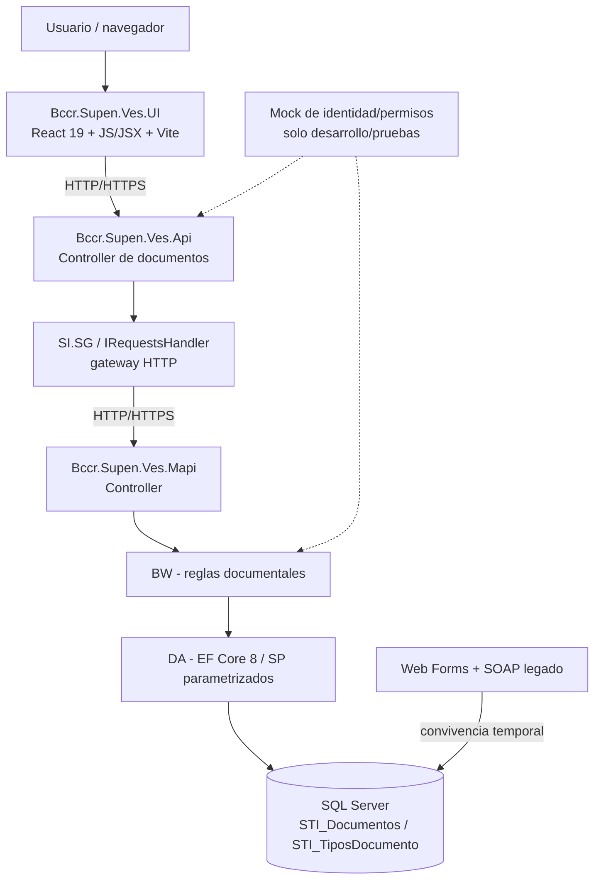

# 02. Arquitectura objetivo — documentos STI

> **Tipo:** diseño objetivo de migración, no inventario de funcionalidades desplegadas. **Alcance:** documentos únicamente; sin comentarios.

## 1. Contexto y restricción principal

En VES existen tres componentes distintos. La migración documental se integra primero a sus límites reales, sin crear un backend Node.js, una capa de persistencia desde la UI ni un servicio compartido supuesto.

El mock representa entradas de seguridad en tests y entornos aislados, no un proveedor real ni un módulo de identidad productivo. Los archivos, según el script de referencia, están en columna `Documento image` en SQL Server. **No dar por confirmado almacenamiento en filesystem o nube**: verificar antes de diseñar una alternativa.

## 2. Responsabilidades por componente

| Componente | Debe hacer | No debe hacer |
|---|---|---|
| UI | Rutas y páginas, formularios, tabla, filtros, estados, carga/descarga con API | Acceder a SOAP/MAPI/SQL, imponer permisos finales |
| API | Exponer endpoints dentro de versionado/patrones reales; validar límites de transporte, mapear DTO, invocar SI.SG | Ejecutar SQL directo, crear arquitectura paralela innecesaria |
| SI.SG / IRequestsHandler | Resolver cliente/endpoint MAPI y traducir solicitudes/respuestas según contratos existentes | Duplicar reglas de negocio |
| MAPI Controller | Entrada HTTP interna, binding y coordinación BW | Contener consultas SQL en controller |
| BW | Validar reglas de documento y autorización funcional simulada, orquestar operaciones | Confiar en controles visuales |
| DA | Ejecutar SQL/SP parametrizados, mapear resultados, manejar recursos | Alterar esquema o generar migraciones EF |
| DBA | Validar/corregir esquema, SP, transacciones y concurrencia | Depender de auto-migración por despliegue |

## 3. Flujos de extremo a extremo

### Consulta de listado y detalle

1. UI solicita documentos y tipos por API, usando filtros y parámetros controlados.
2. API valida paginación y filtro, SI.SG envía al endpoint MAPI existente/adaptado.
3. BW verifica reglas de visibilidad que se acuerden; DA consulta procedimientos autorizados.
4. MAPI/API adaptan la salida a DTOs sin `DataSet` ni binarios en el listado.
5. UI presenta carga, vacío, error o resultados paginados.

El SP de referencia `ListarDocumentos` **omite archivos sin `NombreArchivo` y documentos caducados**, filtra tipo con `-1` y ordena por fecha. No cambiar silenciosamente esto al migrar; decidir y documentar si el mantenimiento debe ver borradores sin archivo.

### Alta/edición

Validar longitud y obligatoriedad, `CodigoTipoDoc` existente cuando aplique, fechas y `Publico` `S/N`. Aplicar caso de uso a través de BW/DA; exigir confirmación de efecto para evitar falsos éxitos. `GuardarDocumento` requiere especialmente pruebas para inserción concurrente, tabla vacía, cambios parciales y valores `NULL`; correcciones SQL deben gestionarse con DBA.

### Carga y descarga

La UI envía multipart a API; API comprueba tamaño, tipo y archivo, y transmite al backend utilizando límites de tamaño/configuración razonables. El SP heredado tiene restricciones y comportamiento especial de `SubirArchivo`: **no utilizar códigos mágicos sin verificar semántica**. Descarga con contenido binario, `Content-Type` permitido y `Content-Disposition` seguro; no devolver base64 dentro de un listado JSON.

### Eliminación

Interfaz solicita confirmación, API/BW verifican permiso **mock**, existencia y regla de negocio, DA invoca operación controlada. Dado que el script `EliminarDocumento` borra físicamente, confirmar la política de reversibilidad y la estrategia de respaldo antes del piloto.

## 4. Contratos e integración

- Modelo externo basado en DTOs explícitos; los nombres de endpoint en `04-backend-api.md` son **propuesta sujeta a alineación** con controllers/versionado actual.
- API y MAPI poseen sus propios modelos `Abstracciones`; mantener mapeos y contratos sincronizados sin suponer ensamblado compartido.
- Respetar logging, DI, manejo de errores, serialización, clientes HTTP y configuración institucional.
- No usar `data-model.md` como prueba de que el SQL se desplegó; contrastarlo con `MAPI/Documentacion/SCHEMA.md`, código DA y DBA.
- La API funcional propuesta no equivale a un `api-spec.yml` desplegado: antes de implementarla, revisar y ajustar el OpenAPI realmente vigente.

## 5. Compatibilidad y despliegue

Web Forms y la nueva ruta pueden convivir durante el piloto; planificar pruebas con el mismo registro y evitar escrituras simultáneas no controladas. Desplegar MAPI, API y UI por sus procedimientos establecidos, con feature flag o habilitación progresiva si el proyecto la soporta; no inventar un flag existente. Registrar métricas funcionales (errores, latencia, carga, descarga, discrepancias) sin exponer datos personales o binarios.

## 6. Seguridad y ambientes

El mock de seguridad **no** sustituye JWT/mTLS o políticas institucionales cuando se usa infraestructura VES real; no desactivar controles existentes para facilitar el prototipo. Si las operaciones del módulo se prueban con mock, hacerlo en rutas/ambientes aislados y no exponerlas a usuarios reales como protegidas. `401/403` simulados describen escenarios de prueba, no certificación de seguridad. Nunca transportar secretos ni activar bypass de certificados fuera de Development.

## 7. Riesgos, decisiones y restricciones arquitectónicas

| Riesgo o incertidumbre | Mitigación/decisión exigida |
|---|---|
| SP heredados con semántica defectuosa | Pruebas controladas y evaluación DBA antes de escritura |
| Nombre de archivo de máximo 30 caracteres en tabla | Política de normalización o ajuste DBA aprobado; preservar nombre descargable según decisión |
| Binario `image` y tamaño de hasta 25 MB propuesto | Validar límites reales, rendimiento, memoria y timeouts |
| Vista de mantenimiento vs filtros del listado actual | Definir visibilidad funcional, sin reescribir silenciosamente el SP |
| Autorización mock | Confinar a pruebas; seguridad real queda fuera de esta entrega |
| React + TypeScript en propuesta antigua | Preferir React 19 JS/JSX existente salvo decisión de nuevo proyecto |
| Dos aplicaciones escribiendo sobre mismos documentos | Matriz de concurrencia, transacciones y plan de rollback |

## 8. Exclusión transversal

No crear `DocumentoComentario`, `DocumentoComentarioHistorialEstado`, endpoints `/comments`, componente de conversaciones, historial de estados ni tablas relacionadas. El documento 06 registra explícitamente esta exclusión y su verificación.
