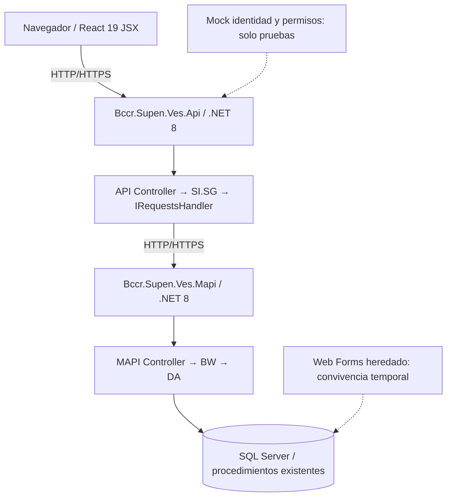
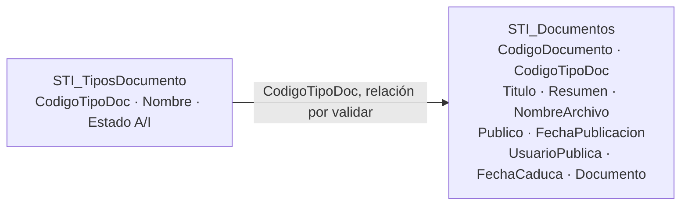

# VES Documentos — Propuesta de migración incremental del módulo STI

> **Estado del documento:** especificación y planificación; no constituye evidencia de implementación ni de despliegue.  
> **Alcance aprobado para esta propuesta:** exclusivamente consulta y mantenimiento de documentos STI y su catálogo de tipos. **Se excluye totalmente la funcionalidad de comentarios de usuarios.**  
> **Arquitectura de referencia:** `Bccr.Supen.Ves.UI → Bccr.Supen.Ves.Api → Bccr.Supen.Ves.Mapi → SQL Server`.

## Índice

0. [Ficha del proyecto](#0-ficha-del-proyecto)
1. [Descripción general del producto](#1-descripción-general-del-producto)
2. [Arquitectura del sistema](#2-arquitectura-del-sistema)
3. [Modelo de datos](#3-modelo-de-datos)
4. [Especificación de la API](#4-especificación-de-la-api)
5. [Historias de usuario](#5-historias-de-usuario)
6. [Tickets de trabajo](#6-tickets-de-trabajo)
7. [Pull requests](#7-pull-requests)
8. [Documentación y decisiones pendientes](#8-documentación-y-decisiones-pendientes)

---

## 0. Ficha del proyecto

### 0.1. Nombre completo del responsable

Pendiente de completar para el entregable.

### 0.2. Nombre del proyecto

**VES Documentos — Migración incremental del módulo documental STI.**

### 0.3. Descripción breve

Modernización gradual de las funcionalidades de consulta, creación, modificación, carga, descarga y eliminación controlada de documentos del sistema VES. La interfaz se incorporará preferentemente al frontend institucional React existente; las solicitudes recorrerán los servicios institucionales API y MAPI, que acceden a SQL Server mediante las capas y procedimientos establecidos. Durante desarrollo y pruebas se simularán identidad y permisos sin implementar la integración real con `SeguridadVES`.

Se conservará la convivencia temporal con ASP.NET Web Forms mientras se validan funcionalidad, integridad y un eventual retorno. **No se desarrollarán comentarios, respuestas, hilos, estados ni historial de comentarios.**

### 0.4. URL del proyecto

Pendiente de completar. Distinguir URL del repositorio, URL de pruebas y URL productiva; no presumir que existe un despliegue.

### 0.5. Repositorio

- Carpeta de trabajo citada en el entregable anterior: `D:\dev\proyectofinal\AI4Devs-finalproject` (**verificar la ubicación vigente**).
- Repositorios/componentes institucionales de referencia: `Bccr.Supen.Ves.UI`, `Bccr.Supen.Ves.Api` y `Bccr.Supen.Ves.Mapi` bajo `VES/`.
- URL del repositorio/PR del entregable: pendiente de completar.

No registrar credenciales, tokens ni cadenas de conexión en este documento. Si se requiere acceso a un repositorio privado, gestionarlo mediante los procedimientos autorizados.

---

## 1. Descripción general del producto

### 1.1. Objetivo

Migrar progresivamente las capacidades del módulo `STI_Documentos` desde páginas ASP.NET Web Forms y servicios heredados hacia la arquitectura actualmente documentada de VES, manteniendo los datos y reglas existentes donde estén comprobados. La nueva experiencia no deberá depender directamente de Web Forms, SOAP, `DataSet` ni SQL Server; los adaptadores y traducciones pertenecerán al backend.

**Objetivos específicos:** facilitar la búsqueda y consulta documental; permitir gestionar metadatos; subir y descargar archivos con restricciones comprobables; aplicar las condiciones reales de eliminación; mantener compatibilidad funcional; verificar cada flujo extremo a extremo; y disponer de un piloto reversible.

La propuesta **no** construye un sistema independiente con Node/Express, PostgreSQL, Prisma o Docker Compose como arquitectura de ejecución. Tampoco presupone tablas adicionales o un rediseño del modelo documental.

### 1.2. Características principales

1. Consultar el catálogo de tipos documentales activos.
2. Listar documentos y aplicar paginación y filtros por tipo/texto, sujeto a validación de soporte en el legado.
3. Consultar el detalle de metadatos de un documento.
4. Crear metadatos de un documento conforme a las validaciones existentes.
5. Actualizar metadatos permitidos y detectar si la operación persistió realmente.
6. Cargar un archivo, con validación de nombre, extensión, MIME y límite propuesto de 25 MiB.
7. Descargar el archivo conservando nombre y tipo de contenido de forma segura.
8. Eliminar documentos solo bajo reglas verificadas y permisos simulados durante las pruebas.
9. Representar estados de carga, error, vacío, éxito y permiso insuficiente.

Las opciones de publicación y visibilidad se limitarán a lo sustentado por los campos legacy (`Publico`, `FechaPublicacion`, `FechaCaduca`, entre otros). **No introducir estados `DRAFT`, `PUBLISHED` o `INACTIVE` como si existieran en el modelo heredado.** No se afirma que exista una bitácora de lecturas que permita demostrar todos los escenarios de eliminación: esa condición debe verificarse previamente.

### 1.3. Diseño y experiencia de usuario

Tres vistas o equivalentes integradas en `Bccr.Supen.Ves.UI/Codigo/src/STI/`:

- **Listado documental:** filtros, paginación, selección y navegación al detalle.
- **Detalle:** metadatos, presencia de archivo, descarga y acciones autorizadas según la política validada.
- **Editor:** alta y edición de metadatos, y carga o sustitución de archivo cuando esté permitida.

Se priorizan los componentes y convenciones existentes: **React 19, JavaScript/JSX, Vite, Material UI v7, React Router DOM 6, cliente HTTP institucional, Vitest y React Testing Library**. El nombre histórico de `03-frontend-react-typescript.md` no significa que el frontend actual sea TypeScript. Un proyecto nuevo en TypeScript requeriría una decisión y diseño propios; no es una condición de este alcance.

Cada vista debe gestionar carga, resultado vacío, fallo del servicio, operación en curso, confirmación de operaciones destructivas y acceso denegado. La UI podrá deshabilitar botones, pero **MAPI/API validarán las reglas de negocio y el backend verificará los permisos del mock** antes de actuar.

Las capturas y el video de demostración quedan pendientes hasta que exista una implementación navegable.

### 1.4. Instalación y ejecución en desarrollo

**Requisitos de referencia (verificar en cada repositorio):**

- UI: Node.js `24.18.0` (según `.nvmrc` documentado), npm y acceso a los paquetes del proyecto.
- API y MAPI: SDK de **.NET 8**; herramientas C# adecuadas y acceso a los feeds NuGet autorizados.
- Conectividad con los servicios y SQL Server de **desarrollo**, mediante red/VPN institucional cuando corresponda.
- Configuración segura de endpoints y secretos según los `README.md`, `AGENT.md`, `SPEC.md` y guías técnicas de cada componente.

**Secuencia orientativa (no sustituye los comandos específicos del repositorio):**

```text
1. Verificar configuración autorizada y conectividad a SQL Server de desarrollo.
2. Restaurar y ejecutar Bccr.Supen.Ves.Mapi.
3. Restaurar y ejecutar Bccr.Supen.Ves.Api apuntando al MAPI permitido.
4. Instalar dependencias e iniciar Bccr.Supen.Ves.UI.
5. Comprobar las URL/puertos efectivos y el flujo UI → API → MAPI.
6. Ejecutar suites automáticas y verificaciones manuales con datos controlados.
```

Ejemplos de comandos **solo cuando coincidan con el proyecto local**:

```powershell
# Dentro del directorio del proyecto .NET correspondiente
dotnet restore
dotnet build
dotnet test

# Dentro de Bccr.Supen.Ves.UI/Codigo
npm ci
npm run dev
```

No asumir `npm run` disponible fuera de la UI ni ejecutar `prisma migrate`, `docker compose up postgres` o `npm run seed` para estos servicios. No generar migraciones EF Core ni modificar esquemas o stored procedures sin el DBA. El mock de identidad debe ser **exclusivo de ambientes de desarrollo/prueba aislados** y no debe sustituir controles institucionales productivos.

### 1.5. Alcance del MVP

Se definen **nueve historias de usuario** (sección 5), correspondientes a seguridad simulada, catálogo, listado, detalle, creación, edición, carga, descarga y eliminación condicionada. Solo se detallan tickets de las **dos primeras historias** para el entregable actual; la descomposición de las demás queda para iteraciones posteriores.

**Exclusiones explícitas:** comentarios de usuarios y sus datos; migración de otros módulos de VES; rediseño general del repositorio; servicio de autenticación real; integración con `SeguridadVES`; publicación externa productiva; bases de datos nuevas; migraciones automáticas de SQL; despliegues productivos sin controles aprobados.

### 1.6. Reglas de negocio y puntos de validación

| ID | Regla o restricción | Condición |
|---|---|---|
| RN-DOC-01 | La creación y edición respetarán tipos, longitudes, nulabilidad y reglas de los objetos SQL efectivos. | Verificación previa con DBA/MAPI |
| RN-DOC-02 | El catálogo procede de `STI_TiposDocumento`, cuyos estados documentados son `A/I`; solo tipos activos podrán elegirse para altas si esa es la regla confirmada. | Contrastar en legado |
| RN-DOC-03 | `Publico` es un valor documental legado `S/N` y no equivale automáticamente a un estado de workflow `PUBLISHED`. | No inventar transición |
| RN-DOC-04 | La propuesta no agrega `DRAFT`, `PUBLISHED` o `INACTIVE` a datos o endpoints sin aprobación y evidencia de soporte. | Obligatorio |
| RN-DOC-05 | Los metadatos requeridos y las fechas se validan en la UI y nuevamente en API/MAPI. | Verificar contrato exacto |
| RN-DOC-06 | Las respuestas de listado usarán paginación explícita; búsqueda textual y orden estable deberán confirmarse o implementarse sin cambios no autorizados al SQL. | Contrato objetivo |
| RN-DOC-07 | Tamaño máximo propuesto de archivo: **25 MiB = 26.214.400 bytes**. Extensiones iniciales: `.pdf`, `.doc`, `.docx`, `.xls`, `.xlsx`, `.pptx`. | Sujeto a infraestructura y contrato aprobado |
| RN-DOC-08 | Archivo ausente/vacío, demasiado grande o tipo no permitido se rechazará de forma controlada (`400`, `413`, `415`). | Contrato objetivo |
| RN-DOC-09 | La eliminación exige que el backend valide el permiso simulado y las reglas reales antes de ejecutar `EliminarDocumento`; no suponer desactivación o historial inexistentes. | Bloqueante antes de implementar borrado |
| RN-DOC-10 | Si se exige que solo el creador elimine y que no haya actividad posterior, deben verificarse las fuentes de autoría y trazabilidad. Si no existen, **no prometer ni implementar borrado inseguro**. | Decisión de negocio/DBA |
| RN-DOC-11 | Errores de SQL/SOAP se traducen a respuestas HTTP controladas; no se exponen detalles internos. | Backend |
| RN-DOC-12 | Sin identidad simulada se representa `401`; con identidad sin permiso, `403`; la comprobación se hace en backend en desarrollo/pruebas. | No implica seguridad productiva |
| RN-DOC-13 | Web Forms y el flujo nuevo coexistirán hasta validar resultado funcional, integridad y plan de reversión. | Piloto |

No se contempla ninguna regla de comentarios. Las reglas relacionadas con publicación definitiva, retiro lógico, auditoría de lecturas y eliminación irreversible **permanecen pendientes** si no están respaldadas por las operaciones reales.

---

## 2. Arquitectura del sistema

### 2.1. Diagrama de arquitectura



Los tres componentes BCCR son **servicios/proyectos independientes**, no carpetas de una única aplicación Node. UI consume exclusivamente API; API se comunica con MAPI; MAPI contiene el acceso a SQL Server. Las dos soluciones .NET disponen de sus propias clases `Abstracciones` y contratos, no de una biblioteca de DTOs común a los tres proyectos.

### 2.2. Responsabilidades

| Componente | Responsabilidades y límites |
|---|---|
| **UI** | Formularios, visualización, navegación, validación de experiencia, estados de carga y consumo de API. Sin llamadas a MAPI, SOAP o SQL. |
| **API (.NET 8)** | Controladores HTTP, validación del contrato, coordinación por `SI.SG` e `IRequestsHandler`, errores y permisos simulados en los casos de prueba. |
| **MAPI (.NET 8)** | Controladores MAPI, `BW` para lógica funcional y `DA` para datos; EF Core 8 y procedimientos almacenados existentes. |
| **SQL Server** | Tablas y procedimientos institucionales; esquema y cambios administrados por DBA. |
| **Mock de seguridad** | Contexto de usuario/permisos para escenarios de desarrollo/prueba. Sin autenticación productiva ni integración con `SeguridadVES`. |

La arquitectura objetivo **no exige** crear una nueva capa DDD, un repositorio genérico, otra base de datos, Prisma, `schema.prisma` ni cambios de framework para entregar esta funcionalidad.

### 2.3. Estructura lógica del trabajo

```text
VES/
├── Bccr.Supen.Ves.UI/
│   └── Codigo/src/
│       ├── STI/                 # pantallas/documentos en estructura verificada
│       ├── componentes/         # reutilización cuando corresponda
│       └── infraestructura/     # cliente HTTP y utilidades actuales
├── Bccr.Supen.Ves.Api/
│   └── ...                     # controllers, SI.SG, contratos en su solución
├── Bccr.Supen.Ves.Mapi/
│   └── ...                     # controllers, BW, DA y contratos en su solución
└── docs/
    ├── 01-alcance-y-principios.md
    ├── 02-arquitectura-objetivo.md
    ├── 03-frontend-react-typescript.md   # título histórico; UI actual JS/JSX
    ├── 04-backend-api.md
    ├── 05-plan-paso-a-paso.md
    ├── 06-manejo-y-mantenimiento-de-comentarios.md # exclusión formal
    └── api-spec.yml
```

Rutas internas de controllers y servicios se determinarán por inspección del código, no a partir de la estructura de un proyecto Node no relacionado.

### 2.4. Infraestructura y despliegue

- Los servicios siguen la operación, configuración y publicación establecidas por BCCR; el README no introduce un despliegue Docker de PostgreSQL.
- En desarrollo, iniciar dependencias en el orden **MAPI → API → UI**, comprobando puertos reales, certificados, proxy y configuración de cada entorno.
- Trabajar exclusivamente con datos controlados y recursos de desarrollo/pruebas autorizados.
- No ejecutar cambios de esquema SQL, migraciones EF o scripts mutantes fuera de los canales de DBA.
- Probar convivencia entre nuevo frontend y Web Forms, incluyendo tratamiento de errores y estrategia de retorno antes de cualquier piloto.

### 2.5. Seguridad simulada

La **seguridad productiva está fuera del alcance de la entrega**. Se simularán una identidad y permisos funcionales para probar las operaciones, con escenarios de usuario presente, ausente y sin permiso. Los códigos `401` y `403` son representaciones de estos escenarios del mock, no evidencia de integración real de identidad.

Los permisos ilustrativos `documents.read`, `documents.create`, `documents.update`, `documents.upload`, `documents.download` y `documents.delete` deberán alinearse con el contrato de pruebas final. No exponer un mecanismo de elección libre de identidad a clientes productivos; no instalar bypass de autenticación, no desactivar políticas existentes y no incluir contraseñas o secretos en código, documentación, fixtures ni reportes.

### 2.6. Pruebas

Las **nueve pruebas funcionales principales** se relacionan con las nueve historias. Esta numeración no limita las pruebas unitarias, de integración, regresión, error ni seguridad simulada que requiera la solución:

- UI: Vitest + React Testing Library.
- API: MSTest para suites existentes y xUnit donde el proyecto ya lo utiliza en integración.
- MAPI: MSTest conforme a sus suites existentes.
- Manual: consultas HTTP controladas y pruebas E2E con Playwright MCP cuando apliquen, ejecutadas y registradas por el agente según `openspec-tasks-mandatory-steps.md`.
- Integridad: verificar efectos antes/después de crear, editar, cargar y eliminar contra el ambiente autorizado, sin manipular directamente los datos para preparar pruebas.

**No declarar una prueba como aprobada sin evidencia de ejecución.**

### 2.7. Requisitos no funcionales

- Respuestas HTTP documentadas, validación backend, errores JSON consistentes y registro seguro de fallos.
- Paginación objetivo: página desde 1, tamaño por defecto 20 y máximo 100 según OpenAPI propuesto.
- Tipos y tamaños de archivo validados en el servidor, considerando límites del pipeline completo.
- Confirmar que nombres de archivo y cadenas caben en las columnas reales (p. ej. `NombreArchivo` de 30 caracteres documentados).
- Accesibilidad alineada con los estándares vigentes de VES (WCAG 2.1 AA documentado).
- Mantener compatibilidad con navegadores institucionales y diseño visual existente.
- Conservar secretos fuera del repositorio; configuración segregada por entorno.
- Reversibilidad y trazabilidad suficiente para explicar qué operación se probó y con qué resultado.

---

## 3. Modelo de datos

### 3.1. Modelo lógico de referencia



**Diagrama conceptual**, no migración propuesta, modelo ORM ni afirmación de integridad referencial efectiva. La correspondencia y las claves deben contrastarse con el esquema real documentado por DBA y MAPI.

### 3.2. Datos documentados

| Fuente | Campo | Observación |
|---|---|---|
| `STI_Documentos` | `CodigoDocumento` | Identificador documental; tipo y mecanismo de generación por verificar. |
| `STI_Documentos` | `CodigoTipoDoc` | Tipo documental nullable según referencia. |
| `STI_Documentos` | `Titulo` | `varchar(100)` documentado. |
| `STI_Documentos` | `Resumen` | `varchar(255)` documentado. |
| `STI_Documentos` | `NombreArchivo` | `varchar(30)` documentado; restringe carga y descarga. |
| `STI_Documentos` | `Publico` | Representación documentada `S/N`; no equivale a `status` enum. |
| `STI_Documentos` | `FechaPublicacion` | Regla de asignación por comprobar. |
| `STI_Documentos` | `UsuarioPublica` | No presumir que sea el creador ni identidad autenticada. |
| `STI_Documentos` | `FechaCaduca` | Fecha opcional según referencia. |
| `STI_Documentos` | `Documento` | Binario documentado como `image` en la referencia legacy. |
| `STI_TiposDocumento` | `CodigoTipoDoc`, `Nombre`, `Estado` | Catálogo; estado `A/I`. |

**No se introducirán** tablas `comments`, `comment_history`, `document_activities`, `document_files`, `documents` ni `document_types` en PostgreSQL como parte de esta migración. Tampoco se presupone una tabla de auditoría: si las reglas de eliminación la requieren, identificar primero una fuente de trazabilidad existente o resolver la limitación con el responsable funcional y DBA.

### 3.3. Persistencia y procedimientos heredados

La adaptación backend partirá de los procedimientos y rutas documentados, que deben verificarse en la solución y el ambiente real: `GuardarDocumento`, `SubirArchivo`, `BajarArchivo` y `EliminarDocumento`, junto con las consultas de listado y detalle. Existen asuntos para revisar antes de afirmar compatibilidad: generación concurrente de IDs, `NULL`, actualizaciones que no persisten, longitud de nombres, descarga y riesgo de borrado irreversible.

No corregir procedimientos, crear tablas ni aplicar cambios EF desde la aplicación. Documentar cada discrepancia, solicitar decisión al DBA y realizar pruebas controladas.

### 3.4. Reglas de integridad

- Validar referencias de tipo antes de crear o modificar.
- Preservar las longitudes y las conversiones entre DTO/SQL; no truncar silenciosamente.
- Verificar las operaciones de escritura y sus efectos reales antes de responder éxito.
- No confundir `Publico` con publicación aprobada o con visibilidad externa funcional.
- Eliminar solo cuando las condiciones de negocio estén aprobadas y sean técnicamente verificables.
- Mantener la tabla/binario institucional como fuente vigente; la localización efectiva del archivo debe verificarse.

---

## 4. Especificación de la API

### 4.1. Endpoints objetivo

| Método | Ruta lógica | Descripción |
|---|---|---|
| `GET` | `/api/document-types` | Listar tipos documentales disponibles. |
| `GET` | `/api/documents` | Listar y filtrar documentos, paginados. |
| `POST` | `/api/documents` | Crear metadatos. |
| `GET` | `/api/documents/{id}` | Obtener detalle. |
| `PUT` | `/api/documents/{id}` | Modificar metadatos. |
| `DELETE` | `/api/documents/{id}` | Eliminar bajo condiciones verificadas. |
| `POST` | `/api/documents/{id}/file` | Cargar o reemplazar archivo cuando esté permitido. |
| `GET` | `/api/documents/{id}/file` | Descargar archivo. |

**Ocho operaciones, cuatro rutas lógicas.** Los endpoints son **contrato objetivo**, no rutas desplegadas verificadas: adaptar nombres y versionado a los controladores y convenciones actuales. **No existen endpoints de comentarios en esta propuesta.** No agregar `PATCH /status` sin regla y fuente de estados documentada.

### 4.2. Consulta y paginación

`GET /api/documents` prevé `page`, `pageSize`, `documentTypeId` y `search`. `page` inicia en 1, `pageSize` por defecto es 20 y máximo 100. Búsqueda, ordenamiento y comportamiento ante filtros inválidos se validarán con el sistema existente; el contrato de paginación no prueba que hoy exista una consulta equivalente.

Ejemplo de **estructura objetivo**, no respuesta real:

```json
{
  "items": [],
  "page": 1,
  "pageSize": 20,
  "total": 0
}
```

### 4.3. Contratos

El archivo [`api-spec.yml`](./api-spec.yml) es la descripción OpenAPI propuesta y define los esquemas `DocumentType`, `Document`, `DocumentSummary`, `CreateDocumentRequest`, `UpdateDocumentRequest`, `PagedDocuments`, `DocumentFileMetadata` y `ApiError`. La serialización final deberá alinearse con los DTOs concretos en las respectivas soluciones `.NET`.

Los campos del contrato permiten representar, por ejemplo, `title`, `summary`, `documentTypeId`, `isPublic` y fechas. Esa nomenclatura es una traducción HTTP de datos heredados, **no prueba de que existan columnas con esos nombres ni de que todos los campos sean editables**.

### 4.4. Archivos y códigos HTTP

**Carga propuesta:** `POST /api/documents/{id}/file`, con `multipart/form-data` y campo obligatorio `file`. Extensiones iniciales: PDF, DOC, DOCX, XLS, XLSX y PPTX; máximo **26.214.400 bytes**. Validar tamaño, extensión y MIME en backend, no solo en interfaz. Comprobar compatibilidad con columna y procedimientos existentes antes de habilitar reemplazos.

**Descarga propuesta:** `GET /api/documents/{id}/file`, con binario, MIME correcto y nombre saneado para `Content-Disposition` cuando corresponda.

| HTTP | Interpretación objetivo |
|---|---|
| `200` | Consulta, edición o carga exitosa según operación. |
| `201` | Documento creado. |
| `204` | Eliminación autorizada completada sin cuerpo. |
| `400` | Validación o solicitud multipart inválida. |
| `401` | Contexto mock sin identidad. |
| `403` | Contexto mock con identidad sin permiso. |
| `404` | Documento o archivo no encontrado. |
| `409` | Operación incompatible con una regla de negocio demostrada. |
| `413` | Archivo superior al máximo. |
| `415` | Tipo/extensión no permitido. |
| `500` | Fallo interno tratado sin filtrar SQL, rutas ni secretos. |

### 4.5. Reglas operativas especiales

La API deberá traducir datos `DataSet`/SOAP cuando el adaptador legacy así lo requiera, coordinar llamadas a MAPI y confirmar los resultados. La comprobación de borrado no puede depender de una bitácora, campo `createdBy` o transiciones de estado que **no consten en el legado**. Si no hay una manera fiable de aplicar la política, bloquear o diferir la eliminación física hasta documentar una solución aprobada. El contrato OpenAPI no constituye aprobación de cambios en la base de datos.

---

## 5. Historias de usuario

Las nueve historias describen **comportamiento objetivo**, no implementación existente. La autorización real, nuevos estados documentales y comentarios están excluidos. Para cada historia se identifica una prueba funcional principal; pueden añadirse cuantas pruebas automatizadas sean necesarias.

### HU-01. Acceder según identidad y permisos simulados

**Como** usuario representado por un contexto de prueba, **quiero** operar el módulo según permisos simulados, **para** verificar funcionalmente accesos permitidos y denegados sin integrar seguridad institucional.

**Criterios de aceptación:** el backend recibe un contexto mock controlado; los permisos necesarios se evalúan antes de la operación; ausencia de identidad se representa por `401` y falta de permiso por `403`; la UI muestra el estado apropiado; el mock no llama a `SeguridadVES`, no sustituye seguridad real y se restringe a desarrollo/pruebas.

**Prueba funcional 1:** verificar una consulta con identidad autorizada, otra sin permiso y otra sin identidad; comprobar el código, la ausencia de fuga de datos y que no se invoque la operación denegada.

### HU-02. Consultar tipos documentales

**Como** usuario del módulo, **quiero** consultar los tipos disponibles, **para** seleccionar un tipo adecuado en la gestión documental.

**Criterios de aceptación:** catálogo basado en `STI_TiposDocumento`; representación de código y nombre; aplicación de estado `A/I` conforme a la regla confirmada; distinción entre catálogo vacío y fallo de consulta; preservación de tipos preexistentes al editar documentos, conforme al comportamiento legado.

**Prueba funcional 2:** consultar un conjunto controlado con tipos activos e inactivos y simular fallo del servicio; verificar filtrado esperado y manejo del error.

### HU-03. Listar y filtrar documentos

**Como** usuario autorizado, **quiero** listar y buscar documentos por tipo o texto, **para** localizarlos eficientemente.

**Criterios de aceptación:** la API ofrece `items`, `page`, `pageSize`, `total`; respeta los límites documentados; filtros y orden son reproducibles; la UI distingue carga, vacío y error; se verifica si las consultas de base soportan esas búsquedas sin alterar incorrectamente las reglas existentes.

**Prueba funcional 3:** consultar páginas y filtros, comprobar resultados estables, entradas inválidas y errores sin resultados engañosos.

### HU-04. Consultar detalle documental

**Como** usuario autorizado, **quiero** consultar los metadatos y la disponibilidad del archivo de un documento, **para** conocer su información antes de gestionarlo.

**Criterios de aceptación:** presentar título, resumen, tipo, indicador `Publico`, fechas y archivo cuando corresponda; no exponer binario en un detalle JSON salvo que el contrato lo establezca; devolver `404` ante identificador inexistente; aplicar el permiso mock.

**Prueba funcional 4:** revisar un documento conocido, uno inexistente y uno denegado, contrastando los campos con la respuesta de API.

### HU-05. Crear documento

**Como** usuario con permiso de creación simulado, **quiero** registrar un documento, **para** incorporar sus metadatos al sistema existente.

**Criterios de aceptación:** validar campos requeridos, longitud, tipo y fechas según esquema comprobado; mapear DTO a operación de `GuardarDocumento` u operación real equivalente; confirmar que se guardó exactamente un registro; manejar errores sin dejar datos inconsistentes; responder `201` únicamente tras éxito real.

**Prueba funcional 5:** alta válida e inválida, verificación del resultado en el entorno de prueba y ausencia de registros incompletos.

### HU-06. Editar metadatos

**Como** usuario con permiso de edición simulado, **quiero** modificar los metadatos autorizados, **para** corregir información documental.

**Criterios de aceptación:** precargar datos existentes; restringir campos y valores conforme a reglas reales; evitar doble envío; confirmar filas/estado persistido, especialmente ante procedimientos que puedan informar éxito sin modificar datos; respetar la nulabilidad y longitud documentadas.

**Prueba funcional 6:** editar metadatos de prueba, recargar detalle y confirmar persistencia; intentar valores inválidos y verificar tratamiento controlado.

### HU-07. Cargar archivo

**Como** usuario con permiso de carga simulado, **quiero** adjuntar un archivo permitido, **para** asociar su contenido al documento.

**Criterios de aceptación:** carga `multipart/form-data`; límite contractual de 25 MiB; tipos iniciales acordados; rechazo `400`, `413` y `415`; nombre compatible con `NombreArchivo`; sustitución solo si la operación y política reales la permiten; integridad ante errores de almacenamiento.

**Prueba funcional 7:** cargar archivo válido, vacío, excesivo y de tipo no permitido; contrastar el resultado persistido y la respuesta HTTP.

### HU-08. Descargar archivo

**Como** usuario con permiso de lectura simulado, **quiero** descargar el archivo de un documento, **para** consultar el contenido original.

**Criterios de aceptación:** validar permiso antes de devolver binario; `Content-Type` correcto; nombre de archivo seguro y consistente; comportamiento `404` si no existe documento o binario; comprobar integridad de bytes del archivo recuperado.

**Prueba funcional 8:** descargar archivo conocido y comparar contenido con el almacenado; probar falta de binario y acceso denegado.

### HU-09. Eliminar documento cuando lo permita la política validada

**Como** usuario con permiso de eliminación simulado, **quiero** retirar un documento incorporado erróneamente conforme a las reglas efectivas, **para** corregir registros sin comprometer la integridad.

**Criterios de aceptación:** confirmación explícita en UI; validación backend de identidad/permisos; comprobación de política de creador/actividad solo cuando haya fuentes acreditadas; rechazo y explicación de situaciones inseguras; invocación de `EliminarDocumento` únicamente después de aprobación; verificación real del efecto y ausencia de referencias rotas. No inventar desactivación lógica si el modelo no la ofrece.

**Prueba funcional 9:** verificar rechazo por falta de permiso y condiciones no comprobables; ejecutar una eliminación solo sobre datos controlados y cuando existan reglas y mecanismos aprobados, confirmando el resultado.

> **Historia retirada:** la antigua HU-10 de comentarios y sus criterios de aceptación **no forman parte del proyecto**. No debe migrarse a tareas, DTOs, rutas, tablas, pantallas ni pruebas.

---

## 6. Tickets de trabajo

La descomposición detallada de este entregable corresponde **solo a HU-01 y HU-02**, siguiendo el criterio del README previo. Los tickets aquí definidos son propuestas de trabajo y **no se marcan como realizados**. Al generar `tasks.md` con OpenSpec, aplicar primero `openspec/config.yaml` y `openspec-tasks-mandatory-steps.md`; las tareas deben ser pequeñas (orientación de hasta 2 horas), comenzar con la rama correspondiente y exigir pruebas y actualización documental.

### 6.1. Tickets de HU-01 — Permisos simulados

#### Ticket HU01-T01 — Preparar escenarios de prueba sin migración de base de datos

**Tipo:** análisis de datos / pruebas; **componente:** MAPI, datos de desarrollo.

**Objetivo:** localizar consultas existentes y preparar identificadores/documentos controlados para escenarios permitidos y denegados, sin crear entidades de autenticación ni cambiar SQL.

**Trabajo:** inspeccionar `STI_Documentos`, tipos y operaciones a través de documentación/DAO; identificar datos aptos para lectura y operaciones reversibles; definir fixtures aislados y reglas de limpieza autorizadas; documentar fuentes y bloqueos. **No usar `schema.prisma`, seeds PostgreSQL ni migraciones EF.**

**Aceptación:** casos reproducibles; ninguna credencial o dato real expuesto; sin mutación de esquema; evidencia del ambiente autorizado. **Prueba relacionada:** 1.

#### Ticket HU01-T02 — Implementar proveedor de contexto de prueba

**Tipo:** backend; **componente:** API y/o MAPI, según punto de aplicación validado.

**Objetivo:** simular usuario/permisos en pruebas mediante la configuración y patrones de inyección de dependencias existentes.

**Trabajo:** definir contexto mock controlado; soportar casos con identidad, sin identidad y con permiso denegado; impedir habilitación accidental en producción; no alterar autenticación institucional; redactar pruebas del proveedor.

**Aceptación:** mock aislado; `401`/`403` reproducibles; no consume `SeguridadVES`; inhabilitación fuera de pruebas comprobable. **Prueba relacionada:** 1.

#### Ticket HU01-T03 — Aplicar validación en el flujo API → MAPI

**Tipo:** backend; **componentes:** `Bccr.Supen.Ves.Api`, `Bccr.Supen.Ves.Mapi` según contratos y responsabilidad real.

**Objetivo:** asegurar que una solicitud documental no autorizada se rechace antes de consultar o cambiar datos.

**Trabajo:** revisar patrón API Controller → SI.SG → IRequestsHandler; establecer dónde se evalúa el mock y cómo viaja el resultado a las operaciones; mantener errores sin revelar detalles; crear pruebas de permitido/denegado.

**Aceptación:** `401`/`403` conforme a contexto; operaciones denegadas no ejecutadas; pruebas automatizadas. **Prueba relacionada:** 1.

#### Ticket HU01-T04 — Representar acceso en interfaz STI

**Tipo:** frontend; **componente:** `Bccr.Supen.Ves.UI`.

**Objetivo:** mostrar vista/documentos o acceso denegado según respuestas del backend.

**Trabajo:** integrar consumo del cliente HTTP institucional en el módulo STI; representar carga, error, `401` y `403`; ocultar o deshabilitar acciones no disponibles sin confiar en UI para autorización.

**Aceptación:** mensajes coherentes; accesibilidad básica; ningún acceso directo a MAPI/SQL; pruebas Vitest/Testing Library. **Prueba relacionada:** 1.

#### Ticket HU01-T05 — Validación completa y evidencia

**Tipo:** integración y pruebas; **componentes:** UI, API, MAPI.

**Objetivo:** demostrar comportamiento consistente en los tres escenarios de mock.

**Trabajo:** ejecutar tests existentes y nuevos; realizar pruebas HTTP controladas y E2E con Playwright MCP cuando aplique; reportar resultados con fecha y ambiente, errores y regresiones; documentar PR.

**Aceptación:** evidencia trazable de escenario permitido, `401`, `403` y no ejecución de operaciones rechazadas; reporte sin secretos. **Prueba relacionada:** 1.

### 6.2. Tickets de HU-02 — Catálogo de tipos documentales

#### Ticket HU02-T01 — Identificar fuente y reglas de catálogo

**Tipo:** análisis de datos; **componente:** MAPI/DA y SQL Server de desarrollo.

**Objetivo:** confirmar `STI_TiposDocumento`, `CodigoTipoDoc`, `Nombre` y `Estado` y la forma institucional de consulta.

**Trabajo:** contrastar esquema documentado con MAPI y DBA; identificar fuente actual y estados `A/I`; preparar datos de prueba autorizados y registrar ordenamiento y casos de error. No crear ni modificar tablas.

**Aceptación:** mapeo SQL/DTO documentado, reglas de tipo activo aprobadas, escenarios controlados definidos. **Prueba relacionada:** 2.

#### Ticket HU02-T02 — Exponer catálogo por MAPI y API

**Tipo:** backend; **componentes:** MAPI (controller/BW/DA) y API (controller/SI.SG).

**Objetivo:** ofrecer `GET /api/document-types` como contrato lógico hacia la UI, respetando el versionado real.

**Trabajo:** reutilizar consultas/procedimientos existentes; mapear DTOs propios de cada servicio; transmitir por gateway; validar filtrado de estados según reglas aprobadas; evitar suposiciones sobre nombres de rutas actuales.

**Aceptación:** respuesta correcta con código/nombre; orden estable; ninguna llamada directa UI → MAPI; tests de capas. **Prueba relacionada:** 2.

#### Ticket HU02-T03 — Manejar fallos del catálogo

**Tipo:** backend; **componentes:** API y MAPI.

**Objetivo:** distinguir catálogo vacío de errores de fuente o comunicación.

**Trabajo:** manejar problemas SQL/MAPI, timeout y transformación de respuesta; registrar información técnica segura; devolver formato JSON y código coherentes con contrato.

**Aceptación:** sin respuesta parcial engañosa ni exposición de SQL o credenciales; tests de éxito/vacío/error. **Prueba relacionada:** 2.

#### Ticket HU02-T04 — Mostrar catálogo en frontend

**Tipo:** frontend; **componente:** UI STI.

**Objetivo:** mostrar tipos válidos para selección y filtro de documentos.

**Trabajo:** llamar a API con infraestructura HTTP existente; ofrecer nombre legible, carga, vacío y error; impedir tipos no permitidos al crear; preservar lógica de visualización de documentos históricos conforme a la regla aprobada.

**Aceptación:** interacción estable y accesible; sin servicios duplicados innecesarios; Vitest/Testing Library. **Prueba relacionada:** 2.

#### Ticket HU02-T05 — Probar extremo a extremo y documentar

**Tipo:** integración y QA; **componentes:** UI, API, MAPI, entorno autorizado.

**Objetivo:** evidenciar catálogo correcto y errores controlados.

**Trabajo:** ejecutar tests, llamadas HTTP y flujo UI con tipos activos/inactivos según la definición validada; simular falla de backend; consignar resultados y actualizar OpenAPI si cambia el contrato.

**Aceptación:** reporte verificable para estados, error y filtros; no se modificó el esquema; PR y documentación alineados. **Prueba relacionada:** 2.

### 6.3. Definition of Done (DoD)

**Ticket terminado:** alcance implementado y probado; revisión de convenciones del componente; compilación/`npm` y suites aplicables ejecutadas con evidencia; ninguna regresión conocida sin registrar; contrato y documentación actualizados cuando proceda; sin secretos; ramas/PR según el repositorio. Los cambios en SQL requieren coordinación y evidencia de DBA, **no** `prisma migrate` ni migraciones EF automáticas.

**Historia terminada:** todos sus tickets necesarios cerrados, prueba funcional principal superada, integraciones y escenarios negativos validados, reglas comprobadas también en backend y evidencia adjunta al cambio OpenSpec.

**MVP terminado:** las **9 historias** documentales implementadas o expresamente delimitadas por decisiones aprobadas, con pruebas pertinentes y revisión de riesgos; contrato API ajustado a endpoints reales; calidad e integridad de archivos; permisos mock restringidos a pruebas; piloto/retorno definidos; sin funcionalidades de comentarios; sin cambios no autorizados en DB y sin afirmaciones sobre seguridad productiva no construida.

---

## 7. Pull requests

Para el entregable se describirán tres PR **reales**, una vez disponibles. Mantener los identificadores, evidencias y ramas verdaderos; no inventar números, enlaces ni resultados. UI y MAPI parten de `dev` y API de `main` **según estándares de referencia**; confirmar el flujo actual de cada repositorio antes de abrirlos.

### Pull Request 1

- **Título:** pendiente de completar.
- **URL:** pendiente de completar.
- **Historia/ticket:** pendiente de completar.
- **Componentes/repositorios:** pendiente de completar.
- **Objetivo y cambios:** pendiente de completar.
- **Pruebas y evidencia:** pendiente de completar.
- **Resultado/estado:** pendiente de completar.

### Pull Request 2

- **Título:** pendiente de completar.
- **URL:** pendiente de completar.
- **Historia/ticket:** pendiente de completar.
- **Componentes/repositorios:** pendiente de completar.
- **Objetivo y cambios:** pendiente de completar.
- **Pruebas y evidencia:** pendiente de completar.
- **Resultado/estado:** pendiente de completar.

### Pull Request 3

- **Título:** pendiente de completar.
- **URL:** pendiente de completar.
- **Historia/ticket:** pendiente de completar.
- **Componentes/repositorios:** pendiente de completar.
- **Objetivo y cambios:** pendiente de completar.
- **Pruebas y evidencia:** pendiente de completar.
- **Resultado/estado:** pendiente de completar.

---

## 8. Documentación y decisiones pendientes

### 8.1. Documentos de la propuesta

| Documento | Función |
|---|---|
| [`01-alcance-y-principios.md`](./01-alcance-y-principios.md) | Alcance exclusivo del módulo documental y restricciones. |
| [`02-arquitectura-objetivo.md`](./02-arquitectura-objetivo.md) | Arquitectura VES y convivencia. |
| [`03-frontend-react-typescript.md`](./03-frontend-react-typescript.md) | Propuesta frontend adaptada a React/JSX; nombre histórico conservado. |
| [`04-backend-api.md`](./04-backend-api.md) | Adaptación API/MAPI, reglas y riesgos. |
| [`05-plan-paso-a-paso.md`](./05-plan-paso-a-paso.md) | Fases y condiciones de avance. |
| [`06-manejo-y-mantenimiento-de-comentarios.md`](./06-manejo-y-mantenimiento-de-comentarios.md) | Constancia de exclusión formal; no funcionalidad. |
| [`api-spec.yml`](./api-spec.yml) | Contrato objetivo OpenAPI sin comentarios. |

Referencias transversales: `data-model.md`, `base-standards.md`, `backend-standards.md`, `frontend-standards.md`, `documentation-standards.md`, `development_guide.md`, `openspec-tasks-mandatory-steps.md`, `openspec/config.yaml` y guías específicas de los repositorios institucionales.

### 8.2. Decisiones por resolver antes de implementar

1. Confirmar rutas/controllers y DTOs existentes, responsabilidades exactas de API y MAPI y correspondencia SQL.
2. Confirmar campos realmente obligatorios/editables, tipos, nulabilidad, formato de `Publico` y restricciones de fechas.
3. Determinar el soporte real de paginación, búsqueda, orden y catálogo activo.
4. Revisar `GuardarDocumento`, `SubirArchivo`, `BajarArchivo` y `EliminarDocumento` contra el código y la base de desarrollo; resolver riesgos de concurrencia, resultados silenciosos, tipo binario y nombres.
5. Acordar la política verificable de eliminación y la fuente de trazabilidad; si falta, aplazar el borrado en lugar de improvisar actividad o estados.
6. Confirmar almacenamiento físico y límites efectivos de carga en todo el recorrido HTTP → SQL; aprobar 25 MiB y extensiones.
7. Validar la integración visual y las pruebas de la UI existente; registrar aparte cualquier decisión de introducir TypeScript.
8. Determinar piloto, entorno, datos de ensayo, aprobaciones y procedimiento de reversión.

### 8.3. Estado de verificación

Este README **alineó la propuesta documental**, pero **no** implica que se hayan ejecutado `dotnet test`, `npm test`, pruebas HTTP, pruebas de base de datos, E2E ni auditoría de producción. Los resultados de esas actividades deben incorporarse posteriormente con fechas, comandos y evidencia verificable.
