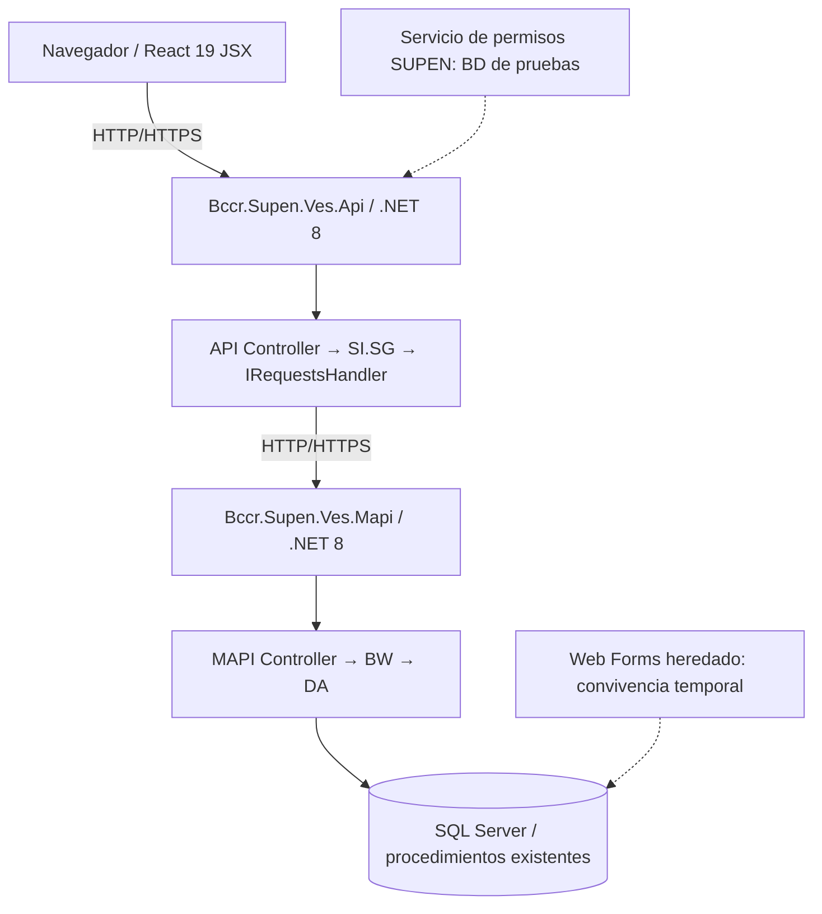
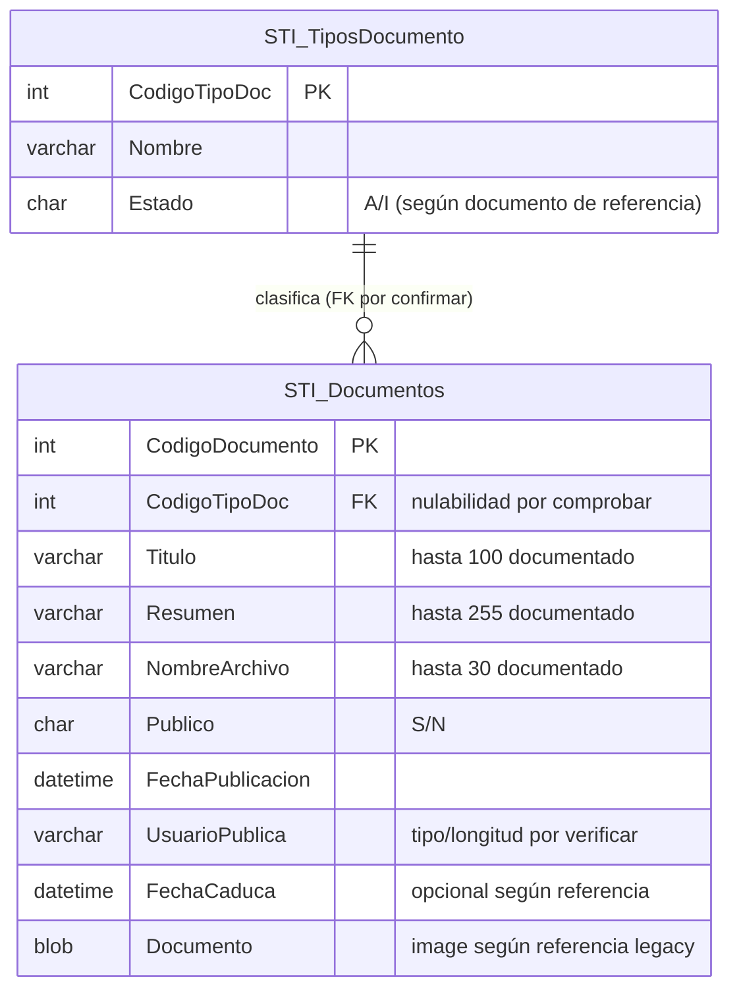

# VES Documentos — Propuesta de migración incremental del módulo STI

> **Estado del documento:** especificación y planificación; no constituye evidencia de implementación ni de despliegue.  
> **Alcance académico priorizado:** listado documental por tipo, botonera estándar SUPEN con permisos consultados en la base de datos de pruebas, consulta de metadatos y previsualización, y descarga de documentos. **Se excluye totalmente la funcionalidad de comentarios de usuarios.**  
> **Propósito central:** demostrar cómo la inteligencia artificial apoya análisis, especificación, generación de código propuesto, pruebas y documentación; el autor no se presenta como desarrollador de software. No se dispone de permisos para administrar servidores ni ejecutar liberaciones institucionales, ni capacidad de implementar o desplegar allí. Se utilizarán datos sintéticos y simuladores locales solo si es viable ejecutarlos.  
> **Arquitectura de referencia:** `Bccr.Supen.Ves.UI → Bccr.Supen.Ves.Api → Bccr.Supen.Ves.Mapi → SQL Server`.

## Índice

0. [Ficha del proyecto](#0-ficha-del-proyecto)
1. [Descripción general del producto](#1-descripción-general-del-producto)
2. [Arquitectura del sistema](#2-arquitectura-del-sistema)
3. [Modelo de datos](#3-modelo-de-datos)
4. [Especificación de la API](#4-especificación-de-la-api)
5. [Historias de usuario](#5-historias-de-usuario)
6. [Tickets de trabajo](#6-tickets-de-trabajo)
7. [Pull requests](#7-pull-requests)
8. [Documentación y decisiones pendientes](#8-documentación-y-decisiones-pendientes)
9. [Demostración independiente y trazabilidad](#9-demostración-independiente-y-trazabilidad)
10. [Video de demostración independiente y trazabilidad](#10-Video)

---

## 0. Ficha del proyecto

### 0.1. Nombre completo del responsable

Eduardo Oreamuno Aparicio

### 0.2. Nombre del proyecto

**VES Documentos — Migración incremental del módulo documental STI.**

### 0.3. Descripción breve y naturaleza de la entrega

Proyecto académico de **investigación aplicada y demostración del apoyo de la IA al ciclo de vida de software**, utilizando como caso de estudio la modernización del módulo documental STI de VES. El responsable **no desempeña el rol de desarrollador de software**: utiliza asistentes de IA para comprender documentación y código disponible, proponer especificaciones, descomponer historias, producir prototipos y diseñar pruebas bajo revisión humana.

**Limitaciones comprobadas por el responsable:** no cuenta con acceso a servidores, bases de datos ni ambientes institucionales para realizar implementaciones, integraciones o despliegues. Por tanto, **no se promete una puesta en producción, integración con SeguridadVES, ejecución de MAPI/SQL institucional ni demostración funcional completa**. Cuando sea viable, el resultado se evidenciará con un vieo ejecutando la aplicación en local; en caso contrario, mediante artefactos verificables (especificaciones, código propuesto, pruebas diseñadas y revisiones). Cualquier prueba no ejecutada se marcará como pendiente.

El alcance funcional inicial se limita a cuatro historias ordenadas: **(1) listado por tipo, (2) botonera estándar SUPEN integrada con permisos de la base de datos de pruebas, (3) consulta de metadatos y previsualización mediante la botonera y (4) descarga mediante la botonera**. La botonera se ajustará a los componentes SUPEN disponibles y consultará permisos efectivos del ambiente de pruebas mediante los servicios autorizados; no se publicará su implementación interna. Se excluyen comentarios, altas, modificaciones, cargas, eliminación y despliegue productivo de este incremento.

### 0.4. URL del proyecto

Repositorio del ejercicio formativo (sin código): https://github.com/EduardoOAp/AI4Devs-finalproject . **No se permite publicar allí código del sistema institucional.** URL de demo institucional y productiva: no acreditadas.

### 0.5. Repositorio

- Carpeta de trabajo citada en el entregable anterior: `D:\dev\proyectofinal\AI4Devs-finalproject` (**verificar la ubicación vigente**).
- Repositorios/componentes institucionales de referencia: `Bccr.Supen.Ves.UI`, `Bccr.Supen.Ves.Api` y `Bccr.Supen.Ves.Mapi` bajo `VES/`.
- URL del repositorio académico: https://github.com/EduardoOAp/AI4Devs-finalproject (identificado en la evaluación; comprobar rama y visibilidad antes de publicar cambios).
- URLs de pull requests: registrar únicamente las que existan y puedan verificarse.

No registrar credenciales, tokens ni cadenas de conexión en este documento. Si se requiere acceso a un repositorio privado, gestionarlo mediante los procedimientos autorizados.

---

### Restricciones de acceso, confidencialidad y liberación

- El autor actúa como **analista y evaluador del aporte de la IA**, no como desarrollador responsable del sistema ni como dueño de su despliegue.
- VES es un **proyecto laboral institucional**: su código fuente, integraciones y artefactos internos **no pueden exponerse en repositorios, plataformas ni entregas académicas** sin autorización institucional expresa. El entregable académico contendrá únicamente material descriptivo permitido, ejemplos creados desde cero con datos sintéticos y conclusiones no sensibles.
- No dispone de permisos suficientes sobre los repositorios y procesos institucionales para aprobar/fusionar cambios, ejecutar el pipeline CI/CD o efectuar liberaciones. No se atribuyen implementaciones, PR, pruebas de servidor o despliegues no ejecutados.
- La **seguridad de la botonera utiliza permisos reales de la base de datos de pruebas** mediante mecanismos institucionales autorizados. Igual con los datos de documentos en pruebas usados únicamente para presentaciones.
- La integración con esa base de pruebas es una dependencia que debe verificarse por personal autorizado. La falta de permisos para liberar no demuestra por sí sola que no exista acceso de consulta a pruebas.

## 1. Descripción general del producto

### 1.1. Objetivo y beneficiarios

**Objetivo académico:** evidenciar, con trazabilidad crítica, cómo la IA puede asistir en la ingeniería de requisitos, la arquitectura, la especificación, la producción de artefactos de código y el diseño de pruebas de un módulo documental sin sustituir decisiones profesionales ni presentar como implementadas propuestas no ejecutadas.

**Necesidad funcional ejemplificada:** una persona autorizada de SUPEN requiere encontrar documentos por su tipo, identificar las acciones disponibles en una botonera común, consultar metadatos y previsualizar un archivo cuando sea posible, y descargar el documento sin confundir la autorización visual con un control de seguridad productivo.

**Roles de referencia (propuestos, pendientes de validación):** usuario consultor de documentos, responsable de definición de permisos de SUPEN y revisor técnico de artefactos generados por IA. Los permisos de la botonera proceden de la base de datos institucional de pruebas; las identidades y autorizaciones efectivas se deben consultar por los servicios establecidos, sin inventar roles.

### 1.2. Características principales de este incremento

1. Mostrar documentos por tipo y una opción «Todos», cuando el contrato de prueba la soporte, con selección de fila y estados vacío/cargando/error.
2. Representar la **botonera estándar de SUPEN** como componente reutilizable, con habilitación/visibilidad de acciones conforme a un permisos de pantalla obtenidos de la base de datos institucional de pruebas.
3. Activar la opción **Abrir** (o el nombre exacto observado y autorizado en la botonera de referencia), mostrando metadatos y previsualización embebida si el archivo y el navegador lo permiten; permitir **Regresar** conservando filtros, página y selección.
4. Activar la opción **Descargar** desde la misma botonera sobre el documento seleccionado, controlando archivo ausente, permiso denegado y errores.

**Fuera de alcance de las cuatro historias:** CRUD de documentos, carga/sustitución, eliminación, comentarios, roles productivos, SQL institucional y despliegues. Las funcionalidades documentadas previamente quedan como antecedentes o posibles etapas futuras sin tickets comprometidos.

### 1.3. Diseño y experiencia de usuario

El prototipo seguirá, en la medida en que los materiales disponibles y autorizados lo permitan, la presentación y reglas de interacción de la **botonera compartida de SUPEN**. Se separará la definición de acciones, su permiso consultado, la selección de filas y su ejecución. Las acciones «Consultar» y «Descargar» requerirán selección y permiso; los botones no autorizados se ocultarán o deshabilitarán según la convención de referencia que se confirme. Esta representación no reemplaza la validación del lado servidor en una eventual implementación institucional.

La pantalla principal agrupará selector de tipo, tabla/listado y botonera. La consulta mostrará el panel tabular de metadatos y, cuando sea seguro y compatible, el visor embebido (preferentemente PDF de ejemplo); para formatos no soportados se mostrará aviso y se ofrecerá la descarga solo si el permiso correspondiente está habilitado. Al regresar se restaurará el contexto previo.

**Tecnologías de referencia, no garantía de ejecución:** React 19 con JavaScript/JSX, Vite, MUI; API y MAPI .NET 8 en un eventual circuito institucional. Para demostrar flujos sin servidores se admitirán fixtures y adaptadores locales claramente identificados como simulación.

### 1.4. Condiciones de ejecución y limitaciones

- No existe acceso disponible a servidores deentornos de despliegue o SQL Server institucional; no solicitar credenciales ni suponer conectividad.
- No se exigirá Docker, Kubernetes, despliegue en contenedores, ni ejecución de integraciones reales para considerar válidos el análisis y los artefactos documentales.
- **El límite del ciclo CI/CD no es Docker ni desconocer los PR, sino carecer de permisos institucionales sobre repositorio, pipelines y ambientes de liberación.** El código laboral no puede publicarse en GitHub académico; cualquier PR o liberación real corresponde a personal autorizado.
- No declarar pruebas «aprobadas», demos ejecutadas, PR creados ni despliegues realizados sin evidencia verificable. La falta de ejecución debe registrarse como limitación, no como defecto oculto.
- No publicar código, modelos de permisos, endpoints ni documentos institucionales no autorizados. Usar datos y PDFs de ejemplo sin información real.

### 1.5. Entregas previstas (sin afirmar implementación)

| Incremento | Historia | Resultado documental mínimo | Demostración opcional si el equipo local lo permite |
|---|---|---|---|
| 1 | HU-01 | Contrato y diseño de listado por tipo; criterios y pruebas | Tabla filtrable con fixtures |
| 2 | HU-02 | Especificación de la botonera SUPEN y matriz de permisos de pruebas | Habilitar/deshabilitar Consultar y Descargar por usuario de prueba |
| 3 | HU-03 | Pantalla de metadatos, visor y navegación | Consultar una fila y regresar sin perder contexto |
| 4 | HU-04 | Contrato de descarga, errores y pruebas | Descargar un PDF sintético autorizado |

La prioridad es **demostrar y evaluar el proceso asistido por IA**; la ejecución de un prototipo es un resultado deseable, pero depende de recursos y habilidades disponibles y no constituye un compromiso de implantación.

### 1.6. Reglas de negocio y puntos de validación

| ID | Regla o restricción | Condición |
|---|---|---|
| RN-DOC-01 | La creación y edición respetarán tipos, longitudes, nulabilidad y reglas de los objetos SQL efectivos. | Verificación previa con DBA/MAPI |
| RN-DOC-02 | El catálogo procede de `STI_TiposDocumento`, cuyos estados documentados son `A/I`; solo tipos activos podrán elegirse para altas si esa es la regla confirmada. | Contrastar en legado |
| RN-DOC-03 | `Publico` es un valor documental legado `S/N` y no equivale automáticamente a un estado de workflow `PUBLISHED`. | No inventar transición |
| RN-DOC-04 | La propuesta no agrega `DRAFT`, `PUBLISHED` o `INACTIVE` a datos o endpoints sin aprobación y evidencia de soporte. | Obligatorio |
| RN-DOC-05 | Los metadatos requeridos y las fechas se validan en la UI y nuevamente en API/MAPI. | Verificar contrato exacto |
| RN-DOC-06 | Las respuestas de listado usarán paginación explícita; búsqueda textual y orden estable deberán confirmarse o implementarse sin cambios no autorizados al SQL. | Contrato objetivo |
| RN-DOC-07 | Tamaño máximo propuesto de archivo: **25 MiB = 26.214.400 bytes**. Extensiones iniciales: `.pdf`, `.doc`, `.docx`, `.xls`, `.xlsx`, `.pptx`. | Sujeto a infraestructura y contrato aprobado |
| RN-DOC-08 | Archivo ausente/vacío, demasiado grande o tipo no permitido se rechazará de forma controlada (`400`, `413`, `415`). | Contrato objetivo |
| RN-DOC-09 | La eliminación exige que el backend valide el permiso obtenido de pruebas y las reglas reales antes de ejecutar `EliminarDocumento`; no suponer desactivación o historial inexistentes. | Bloqueante antes de implementar borrado |
| RN-DOC-10 | Si se exige que solo el creador elimine y que no haya actividad posterior, deben verificarse las fuentes de autoría y trazabilidad. Si no existen, **no prometer ni implementar borrado inseguro**. | Decisión de negocio/DBA |
| RN-DOC-11 | Errores de SQL/SOAP se traducen a respuestas HTTP controladas; no se exponen detalles internos. | Backend |
| RN-DOC-12 | La ausencia de identidad válida y la falta de autorización se manejan mediante los mecanismos institucionales existentes; `401`/`403` son respuestas candidatas sujetas a confirmar con los contratos reales. | No implica seguridad productiva |
| RN-DOC-13 | Web Forms y el flujo nuevo coexistirán hasta validar resultado funcional, integridad y plan de reversión. | Piloto |

No se contempla ninguna regla de comentarios. Las reglas relacionadas con publicación definitiva, retiro lógico, auditoría de lecturas y eliminación irreversible **permanecen pendientes** si no están respaldadas por las operaciones reales.

---

## 2. Arquitectura del sistema

### 2.1. Diagrama de arquitectura



**Patrón de modernización:** *Strangler Fig* (sustitución gradual de capacidades heredadas) combinado con separación por servicios/API de fachada. La funcionalidad nueva se incorpora por incrementos mientras la operación legacy permanece disponible.

**Beneficios:** convivencia, menor riesgo de cambio integral, posibilidad de comparar resultados y revertir la ruta funcional. **Costos y sacrificios:** coexistencia temporal de dos experiencias, contratos de traducción y adaptadores, pruebas de equivalencia entre flujos, duplicación transitoria de operaciones y mayor carga de coordinación. La reversibilidad real **no está demostrada** hasta ensayar el plan de retorno.

**Demostración académica sin código institucional:** puede mostrar el flujo documental con datos sintéticos creados desde cero. Esa demostración no acredita consulta de permisos reales. La HU-02 solo se valida conectada mediante los servicios autorizados al ambiente de pruebas; de no existir acceso, queda bloqueada.

Los tres componentes BCCR son **servicios/proyectos independientes**, no carpetas de una única aplicación Node. UI consume exclusivamente API; API se comunica con MAPI; MAPI contiene el acceso a SQL Server. Las dos soluciones .NET disponen de sus propias clases `Abstracciones` y contratos, no de una biblioteca de DTOs común a los tres proyectos.

### 2.2. Responsabilidades

| Componente | Responsabilidades y límites |
|---|---|
| **UI** | Formularios, visualización, navegación, validación de experiencia, estados de carga y consumo de API. Sin llamadas a MAPI, SOAP o SQL. |
| **API (.NET 8)** | Controladores HTTP, validación del contrato, coordinación por `SI.SG` e `IRequestsHandler`, errores y permisos de la base de datos de pruebas, cuando exista acceso autorizado. |
| **MAPI (.NET 8)** | Controladores MAPI, `BW` para lógica funcional y `DA` para datos; EF Core 8 y procedimientos almacenados existentes. |
| **SQL Server** | Tablas y procedimientos institucionales; esquema y cambios administrados por DBA. |
| **Servicio institucional de permisos** | Contexto de usuario/permisos para escenarios de desarrollo/prueba. Sin autenticación productiva ni integración con `SeguridadVES`. |

La arquitectura objetivo **no exige** crear una nueva capa DDD, un repositorio genérico, otra base de datos, Prisma, `schema.prisma` ni cambios de framework para entregar esta funcionalidad.

### 2.3. Estructura lógica del trabajo

```text
VES/
├── Bccr.Supen.Ves.UI/
│   └── Codigo/src/
│       ├── STI/                 # pantallas/documentos en estructura verificada
│       ├── componentes/         # reutilización cuando corresponda
│       └── infraestructura/     # cliente HTTP y utilidades actuales
├── Bccr.Supen.Ves.Api/
│   └── ...                     # controllers, SI.SG, contratos en su solución
├── Bccr.Supen.Ves.Mapi/
│   └── ...                     # controllers, BW, DA y contratos en su solución
└── docs/
    ├── 01-alcance-y-principios.md
    ├── 02-arquitectura-objetivo.md
    ├── 03-frontend-react-typescript.md   # título histórico; UI actual JS/JSX
    ├── 04-backend-api.md
    ├── 05-plan-paso-a-paso.md
    ├── 06-manejo-y-mantenimiento-de-comentarios.md # exclusión formal
    └── api-spec.yml
```

Rutas internas de controllers y servicios se determinarán por inspección del código, no a partir de la estructura de un proyecto Node no relacionado.

### 2.4. Infraestructura y despliegue

- Los servicios siguen la operación, configuración y publicación establecidas por BCCR; el README no introduce un despliegue Docker de PostgreSQL.
- En desarrollo, iniciar dependencias en el orden **MAPI → API → UI**, comprobando puertos reales, certificados, proxy y configuración de cada entorno.
- Trabajar exclusivamente con datos controlados y recursos de desarrollo/pruebas autorizados.
- No ejecutar cambios de esquema SQL, migraciones EF o scripts mutantes fuera de los canales de DBA.
- Probar convivencia entre nuevo frontend y Web Forms, incluyendo tratamiento de errores y estrategia de retorno antes de cualquier piloto.

### 2.5. Seguridad de la botonera en el ambiente de pruebas

Los **permisos de la botonera no se simulan**: se consultan en la **base de datos institucional de pruebas** a través de los servicios y convenciones autorizados de SUPEN/VES. La botonera debe comportarse según los permisos reales asignados al usuario de pruebas para la pantalla y cada opción, además de depender de la selección de un documento cuando corresponda.

Esto **no equivale a disponer de permisos administrativos, capacidad de despliegue ni integración con producción**. No se implementa un mecanismo alterno de autenticación ni se omiten verificaciones existentes. Si el autor no dispone de credenciales, conectividad o un servicio autorizado para consultar la base de pruebas desde su entorno, se documenta el impedimento; no se sustituye la consulta real de permisos por una respuesta ficticia ni se afirma que la integración fue comprobada. Esto es igual con la base de datos de documentos de pruebas que puede usarse únicamente para mostrar listado, metadatos y archivos fuera de la institución, sin presentarlos como registros reales.

Verificar antes de implementar la ruta institucional disponible, códigos de opciones y decisiones de visibilidad/habilitación. La autorización efectiva de operaciones debe validarse también del lado servidor. No registrar credenciales, identificaciones personales, datos reales de permisos ni cadenas de conexión en material académico.

## 3. Modelo de datos

### 3.1. Modelo entidad-relación de referencia



**Interpretación del diagrama:** `CodigoDocumento` y `CodigoTipoDoc` son **claves lógicas propuestas/inferidas a partir del dominio y SQL documentado**, no certificación de restricciones `PRIMARY KEY`/`FOREIGN KEY` existentes. La cardinalidad 1:N es esperada cuando existe un tipo asociado; si `CodigoTipoDoc` admite `NULL`, un documento podría no tener tipo, por lo que la obligatoriedad de la relación no está demostrada. Los tipos `int`, `varchar`, `datetime`, `blob` se muestran como **representaciones orientativas** excepto donde las referencias permiten más precisión; consultar DDL, `SCHEMA.md` y DBA antes de declararlos tipos físicos definitivos. Ninguna entidad nueva se propone.

**Restricciones y relaciones a comprobar:** unicidad y generación de identificadores; FK física y comportamiento con tipo inactivo/ausente; `NULL` y valores por defecto; límites exactos y `CHECK` de `Publico`/`Estado`; reglas sobre vigencia; datos binarios y longitud del nombre; eliminación en cascada o bloqueo; integridad y transacciones de procedimientos. No realizar cambios de esquema para resolver ambigüedades del ejercicio.

### 3.2. Datos documentados

| Fuente | Campo | Observación |
|---|---|---|
| `STI_Documentos` | `CodigoDocumento` | Identificador documental. |
| `STI_Documentos` | `CodigoTipoDoc` | Tipo documental nullable según referencia. |
| `STI_Documentos` | `Titulo` | `varchar(100)` documentado. |
| `STI_Documentos` | `Resumen` | `varchar(255)` documentado. |
| `STI_Documentos` | `NombreArchivo` | `varchar(30)` documentado; restringe carga y descarga. |
| `STI_Documentos` | `Publico` | Representación documentada `S/N`; no equivale a `status` enum. |
| `STI_Documentos` | `FechaPublicacion` | Fecha en que el usuario registra el dcoumento. |
| `STI_Documentos` | `UsuarioPublica` | Código de usuario que registra el documento. |
| `STI_Documentos` | `FechaCaduca` | Fecha opcional según referencia. |
| `STI_Documentos` | `Documento` | Binario documentado como `image` en la referencia legacy. |
| `STI_TiposDocumento` | `CodigoTipoDoc`, `Nombre`, `Estado` | Catálogo; estado `A/I`. |

### 3.3. Persistencia y procedimientos heredados

La adaptación backend partirá de los procedimientos y rutas documentados, que deben verificarse en la solución y el ambiente real: `GuardarDocumento`, `SubirArchivo`, `BajarArchivo` y `EliminarDocumento`, junto con las consultas de listado y detalle. Existen asuntos para revisar antes de afirmar compatibilidad: generación concurrente de IDs, `NULL`, actualizaciones que no persisten, longitud de nombres, descarga y riesgo de borrado irreversible.

No corregir procedimientos, crear tablas ni aplicar cambios EF desde la aplicación. Documentar cada discrepancia, solicitar decisión al DBA y realizar pruebas controladas.

### 3.4. Reglas de integridad

- Validar referencias de tipo antes de crear o modificar.
- Preservar las longitudes y las conversiones entre DTO/SQL; no truncar silenciosamente.
- Verificar las operaciones de escritura y sus efectos reales antes de responder éxito.
- No confundir `Publico` con publicación aprobada o con visibilidad externa funcional.
- Eliminar solo cuando las condiciones de negocio estén aprobadas y sean técnicamente verificables.
- Mantener la tabla/binario institucional como fuente vigente; la localización efectiva del archivo debe verificarse.

---

## 4. Especificación de la API

### 4.1. Endpoints objetivo

| Método | Ruta lógica | Descripción |
|---|---|---|
| `GET` | `/api/document-types` | Listar tipos documentales disponibles. |
| `GET` | `/api/documents` | Listar y filtrar documentos, paginados. |
| `POST` | `/api/documents` | Crear metadatos. |
| `GET` | `/api/documents/{id}` | Obtener detalle. |
| `PUT` | `/api/documents/{id}` | Modificar metadatos. |
| `DELETE` | `/api/documents/{id}` | Eliminar bajo condiciones verificadas. |
| `POST` | `/api/documents/{id}/file` | Cargar o reemplazar archivo cuando esté permitido. |
| `GET` | `/api/documents/{id}/file` | Descargar archivo. |

**Ocho operaciones, cuatro rutas lógicas.** Los endpoints son **contrato objetivo**, no rutas desplegadas verificadas: adaptar nombres y versionado a los controladores y convenciones actuales. No agregar `PATCH /status` sin regla y fuente de estados documentada.

### 4.2. Consulta y paginación

`GET /api/documents` prevé `page`, `pageSize`, `documentTypeId` y `search`. `page` inicia en 1, `pageSize` por defecto es 20 y máximo 100. Búsqueda, ordenamiento y comportamiento ante filtros inválidos se validarán con el sistema existente; el contrato de paginación no prueba que hoy exista una consulta equivalente.

Ejemplo de **estructura objetivo**, no respuesta real:

```json
{
  "items": [],
  "page": 1,
  "pageSize": 20,
  "total": 0
}
```

### 4.3. Contratos

El archivo [`api-spec.yml`](./docs/react-typescript-proposal/api-spec.yml) es la descripción OpenAPI propuesta y define los esquemas `DocumentType`, `Document`, `DocumentSummary`, `CreateDocumentRequest`, `UpdateDocumentRequest`, `PagedDocuments`, `DocumentFileMetadata` y `ApiError`. La serialización final deberá alinearse con los DTOs concretos en las respectivas soluciones `.NET`.

Los campos del contrato permiten representar, por ejemplo, `title`, `summary`, `documentTypeId`, `isPublic` y fechas. Esa nomenclatura es una traducción HTTP de datos heredados, **no prueba de que existan columnas con esos nombres ni de que todos los campos sean editables**.

### 4.4. Archivos y códigos HTTP

**Carga propuesta:** `POST /api/documents/{id}/file`, con `multipart/form-data` y campo obligatorio `file`. Extensiones iniciales: PDF, DOC, DOCX, XLS, XLSX y PPTX; máximo **26.214.400 bytes**. Validar tamaño, extensión y MIME en backend, no solo en interfaz. Comprobar compatibilidad con columna y procedimientos existentes antes de habilitar reemplazos.

**Descarga propuesta:** `GET /api/documents/{id}/file`, con binario, MIME correcto y nombre saneado para `Content-Disposition` cuando corresponda.

| HTTP | Interpretación objetivo |
|---|---|
| `200` | Consulta, edición o carga exitosa según operación. |
| `201` | Documento creado. |
| `204` | Eliminación autorizada completada sin cuerpo. |
| `400` | Validación o solicitud multipart inválida. |
| `401` | Ausencia de autenticación válida, si así lo establece el contrato institucional. |
| `403` | Usuario sin autorización según el servicio de seguridad del entorno de pruebas, sujeto a contrato. |
| `404` | Documento o archivo no encontrado. |
| `409` | Operación incompatible con una regla de negocio demostrada. |
| `413` | Archivo superior al máximo. |
| `415` | Tipo/extensión no permitido. |
| `500` | Fallo interno tratado sin filtrar SQL, rutas ni secretos. |

### 4.5. Reglas operativas especiales

La API deberá traducir datos `DataSet`/SOAP cuando el adaptador legacy así lo requiera, coordinar llamadas a MAPI y confirmar los resultados. La comprobación de borrado no puede depender de una bitácora, campo `createdBy` o transiciones de estado que **no consten en el legado**. Si no hay una manera fiable de aplicar la política, bloquear o diferir la eliminación física hasta documentar una solución aprobada. El contrato OpenAPI no constituye aprobación de cambios en la base de datos.

---

## 5. Historias de usuario

Estas cuatro historias sustituyen la priorización anterior. Son **funcionalidades desplegadas**. Se redactan desde el usuario y describen lo que debe demostrarse o, si no es ejecutable, especificarse y someterse a revisión. La secuencia es HU-01 → HU-02 → HU-03 → HU-04.

### HU-01 — Listar documentos por tipo

**Como** usuario autorizado del módulo documental de SUPEN, **quiero** consultar un listado de documentos y filtrarlo por tipo documental, **para** localizar de forma rápida los documentos que necesito revisar.

**Descripción:** la pantalla presenta el selector de tipos y un listado de documentos con información resumida. El resultado se actualiza según el tipo seleccionado, conservando un comportamiento coherente ante resultados vacíos o fallos. La selección de una fila se usará en las historias posteriores.

**Criterios de aceptación:**

1. **Dado** que existen documentos de varios tipos en los datos de prueba, **cuando** selecciono un tipo, **entonces** se muestran únicamente los documentos correspondientes a ese tipo.
2. **Dado** que la opción «Todos» está definida en el catálogo de prueba, **cuando** la selecciono, **entonces** se muestran documentos de todos los tipos elegibles sin duplicaciones.
3. **Dado** un tipo sin documentos, **cuando** se aplica el filtro, **entonces** aparece un estado vacío diferenciable de un fallo técnico.
4. **Dado** un error, **cuando** intento consultar, **entonces** la pantalla informa el problema sin mostrar resultados falsos.
5. El listado permite seleccionar una sola fila a la vez y conservar el tipo/página seleccionados mientras se usa la pantalla. La paginación, si se incluye en el prototipo, debe ser consistente con el contrato objetivo.

**Prueba funcional principal PF-01:**, comprobar el filtrado por dos tipos, «Todos», vacío, error y selección; guardar evidencia o marcar ejecución pendiente.

### HU-02 — Incorporar la botonera estándar SUPEN vinculada a permisos de la base de datos de pruebas

**Como** usuario autorizado del módulo documental de SUPEN, **quiero** visualizar la botonera estándar de la pantalla con las opciones habilitadas conforme a los permisos que tengo registrados en la base de datos de pruebas, **para** ejecutar únicamente las acciones documentales autorizadas sobre el registro seleccionado.

**Descripción:** reutilizar o replicar, según los componentes institucionales disponibles y autorizados, el patrón de botonera estándar de SUPEN. Las opciones del alcance son **Abrir** y **Descargar**; **Regresar** se aplica a la navegación del detalle. Los permisos se consultan mediante el mecanismo institucional que obtiene las autorizaciones desde la base de datos de pruebas. La disponibilidad de una acción también depende de que exista selección cuando corresponda. Los identificadores exactos de opción y la política de mostrar u ocultar deben comprobarse en la implementación de referencia.

**Criterios de aceptación:**

1. **Dado** un usuario de pruebas con permiso de consulta registrado en la base de datos de pruebas, **cuando** accede a la pantalla, **entonces** Consultar se presenta conforme al comportamiento estándar de SUPEN.
2. **Dado** un usuario de pruebas sin permiso de descarga, **cuando** se resuelven sus autorizaciones desde pruebas, **entonces** Descargar no puede ejecutarse y su presentación respeta la convención institucional.
3. **Dado** que no existe documento seleccionado, **cuando** se intenta una acción que requiere selección, **entonces** no se ejecuta aunque el usuario tenga permiso.
4. **Dado** un documento seleccionado y una autorización obtenida del servicio institucional de pruebas, **cuando** el usuario acciona Consultar o Descargar, **entonces** se ejecuta solamente la opción autorizada y se valida el acceso del lado servidor.
5. **Dado** que falla la consulta de permisos, **cuando** se carga la botonera, **entonces** se deniegan por defecto las acciones protegidas y se informa el fallo sin revelar datos sensibles.

**Prueba funcional principal PF-02:** con cuentas de pruebas autorizadas y permisos configurados por los responsables correspondientes, verificar Consultar, Descargar, denegación, ausencia de selección y error de consulta. Si no se dispone del acceso necesario, registrar **prueba bloqueada**, nunca «aprobada con simulación».

### HU-03 — Consultar metadatos y previsualizar el documento mediante la botonera

**Como** usuario autorizado del módulo documental de SUPEN, **quiero** seleccionar un documento del listado y ejecutar la opción **Abrir** de la botonera para ver sus metadatos y, cuando sea posible, una previsualización de su contenido, **para** verificar la información antes de decidir si debo descargarlo.

**Criterios de aceptación:**

1. **Dado** un documento seleccionado y permiso obtenido de pruebas Consultar, **cuando** presiono Consultar, **entonces** se abre la pantalla o panel de detalle del documento correcto.
2. El detalle presenta, cuando el contrato los suministre, código, título, nombre del archivo, tipo, fecha de publicación, vigencia/caducidad, publicado por y resumen/descripción, indicando valores no disponibles sin inventarlos.
3. **Dado** un PDF  compatible y disponible, **cuando** abro el detalle, **entonces** aparece una previsualización embebida; si el formato no es compatible o no existe archivo, se indica expresamente y no se promete un visor universal.
4. **Dado** un documento inexistente o sin permiso de consulta, **cuando** solicito el detalle, **entonces** se muestra un mensaje controlado y no se expone contenido.
5. **Dado** el listado con filtros, orden, página y selección, **cuando** uso Regresar, **entonces** se restaura exactamente el contexto anterior documentado; el prototipo no reinicia el filtro.

**Prueba funcional principal PF-03:** seleccionar un documento conocido, consultar metadatos, visualizar un PDF, probar archivo no previsualizable/inexistente y regresar comprobando contexto conservado.

### HU-04 — Descargar el archivo del documento seleccionado mediante la botonera

**Como** usuario autorizado del módulo documental de SUPEN, **quiero** seleccionar un documento del listado y ejecutar **Descargar** en la botonera, **para** obtener el archivo asociado cuando esté disponible y tenga permiso para ello.

**Criterios de aceptación:**

1. **Dado** un documento seleccionado, permiso obtenido de pruebas Descargar y archivo disponible, **cuando** pulso Descargar, **entonces** se inicia la descarga del archivo asociado a esa selección, con nombre y extensión coherentes.
2. **Dado** que no hay fila seleccionada, **cuando** intento descargar, **entonces** la acción no se ejecuta.
3. **Dado** un rol sin permiso obtenido de pruebas Descargar, **cuando** intenta la acción, **entonces** no obtiene el contenido; la demostración deja claro que el control de interfaz no reemplaza una validación real del servidor.
4. **Dado** un documento sin archivo, inexistente o con error del origen, **cuando** solicito descargar, **entonces** se informa el resultado sin generar un archivo incorrecto.
5. La descarga no modifica el filtro, la página ni la selección del listado, y el archivo sintético descargado coincide en contenido con el fixture original.

**Prueba funcional principal PF-04:** descargar el PDF de ejemplo y verificar nombre/contenido; repetir con permiso denegado, sin selección y archivo ausente, dejando evidencia o estado pendiente.

**Fuera del backlog inmediato:** creación, edición, carga, sustitución y eliminación de documentos, comentarios, autenticación institucional y despliegue. Si llegan a proponerse, se requerirá una decisión de alcance nueva y otras historias independientes.

---

## 6. Tickets de trabajo

Los tickets mantienen la estructura **identificador, tipo, componente, objetivo, trabajo, aceptación y prueba funcional**, y están organizados por cada una de las cuatro historias. Ninguno se considera ejecutado solo por figurar aquí. Cuando una tarea requiera sistemas inaccesibles, su salida válida será una **especificación/revisión o un mock local declarado**, nunca una integración simulada presentada como real. Se consultarán las reglas de OpenSpec únicamente si los archivos existen en la rama disponible.

### 6.1. Tickets de HU-01 — Listado de documentos por tipo

#### Ticket HU01-T01 — Analizar el listado legado y definir el contrato de lectura

**Tipo:** análisis y especificación; **componentes:** documental, API/MAPI de referencia. **Objetivo:** identificar columnas, filtros, identificadores y reglas de consulta por tipo.

**Trabajo:** estudiar `ListarDocumentos.aspx`/code-behind y documentos disponibles; distinguir fuentes verificadas de inferidas; definir DTO y casos tipo/todos/vacío/error; registrar límites por falta de SQL.

**Aceptación:** matriz fuente-regla-evidencia y contrato objetivo documentados, sin presentar rutas hipotéticas como implementadas. **Prueba relacionada:** PF-01.

#### Ticket HU01-T02 — Preparar tipos y documentos sintéticos

**Tipo:** datos de prueba; **componentes:** fixtures/adaptador de prueba. **Objetivo:** disponer de un conjunto reproducible, sin datos institucionales.

**Trabajo:** crear varios tipos y documentos, caso sin resultados y fallos simulados; documentar identificadores y resultados esperados.

**Aceptación:** fixtures coherentes, versionables y sin datos sensibles; pruebas de correspondencia tipo/documento diseñadas. **Prueba relacionada:** PF-01.

#### Ticket HU01-T03 — Diseñar o generar el servicio local de listado

**Tipo:** servicio simulado; **componentes:** contrato API / mock opcional. **Objetivo:** suministrar datos filtrados a la interfaz sin servidores.

**Trabajo:** especificar e implementar solo si es viable un adaptador local respetando el contrato objetivo, sin conexiones SQL ni llamadas a MAPI institucional.

**Aceptación:** filtrado estable por código de tipo, respuesta a todos/vacío/error; si no se ejecuta, contrato y pruebas quedan señalados como pendientes de validación. **Prueba relacionada:** PF-01.

#### Ticket HU01-T04 — Diseñar la pantalla de listado

**Tipo:** frontend; **componente:** React/JSX de referencia o prototipo. **Objetivo:** presentar tabla, selector de tipo y selección.

**Trabajo:** reutilizar patrones MUI documentados; manejar carga/vacío/error; conservar filtro y página; no introducir acciones fuera del alcance.

**Aceptación:** diseño y componentes propuestos trazados a HU-01; si hay prototipo, flujo comprobable con fixtures. **Prueba relacionada:** PF-01.

#### Ticket HU01-T05 — Validar y documentar el listado

**Tipo:** QA/documentación; **componentes:** pruebas y README. **Objetivo:** demostrar —o especificar honestamente— el comportamiento del filtro.

**Trabajo:** definir/ejecutar casos por tipo/todos/vacío/error y registrar capturas, resultados, o bloqueo de ejecución.

**Aceptación:** matriz caso/resultado/estado/evidencia; no se marca aprobado sin ejecución. **Prueba relacionada:** PF-01.

### 6.2. Tickets de HU-02 — Botonera estándar y permisos reales del ambiente de pruebas

#### Ticket HU02-T01 — Caracterizar la botonera SUPEN de referencia

**Tipo:** análisis funcional; **componente:** documentación/UI. **Objetivo:** identificar el componente estándar, acciones, ubicación, accesibilidad, requisitos de selección y comportamiento visual.

**Trabajo:** revisar las referencias institucionales disponibles y autorizadas; identificar Consultar, Descargar y Regresar, así como las convenciones de habilitación/ocultamiento; registrar hallazgos y aspectos por verificar.

**Aceptación:** especificación trazable de la botonera sin copiar código institucional en repositorios académicos. **Prueba relacionada:** PF-02.

#### Ticket HU02-T02 — Identificar permisos y opciones de la pantalla en pruebas

**Tipo:** análisis e integración de autorización; **componentes:** seguridad VES/SUPEN y base de datos de pruebas. **Objetivo:** documentar cómo se determinan los permisos efectivos de Consultar y Descargar.

**Trabajo:** identificar con personal autorizado el servicio existente, códigos de módulo, pantalla y opción, identidad de pruebas, reglas de acceso y configuración; verificar el contrato disponible sin exponer datos ni accesos internos.

**Aceptación:** correspondencia verificable entre opción y permiso; las dependencias y las validaciones pendientes constan explícitamente. **Prueba relacionada:** PF-02.

#### Ticket HU02-T03 — Incorporar la botonera reutilizable en el listado

**Tipo:** frontend; **componente:** UI React/JSX. **Objetivo:** utilizar el patrón estándar institucional y desacoplar la presentación de las operaciones.

**Trabajo:** mostrar las opciones autorizadas según respuesta del servicio de permisos, integrar selección y acciones; mantener accesibilidad y estados carga/error; no introducir autorización ficticia.

**Aceptación:** ninguna acción protegida se ejecuta por falta de selección o autorización; código y pruebas revisables dentro del entorno permitido. **Prueba relacionada:** PF-02.

#### Ticket HU02-T04 — Integrar consulta autorizada de permisos de pruebas

**Tipo:** backend/integración; **componentes:** API/MAPI o servicio institucional de seguridad existente. **Objetivo:** obtener los permisos efectivos desde la base de datos de pruebas sin conectar la UI directamente a SQL Server.

**Trabajo:** reutilizar el flujo autorizado y sus contratos, validar usuario y opciones, manejar fallos con denegación por defecto y comprobar autorización del lado servidor; no copiar credenciales ni modificar la base. La imposibilidad de ejecutar la integración se documentará como dependencia bloqueada.

**Aceptación:** evidencia de consulta real solo si fue autorizada y ejecutada; de lo contrario, diseño verificable y estado **pendiente/bloqueado**, nunca mock descrito como acceso real. **Prueba relacionada:** PF-02.

#### Ticket HU02-T05 — Probar permisos, selección y ejecución de acciones

**Tipo:** QA; **componentes:** UI y autorización de pruebas. **Objetivo:** comprobar la matriz permiso × selección × acción y el tratamiento de errores.

**Trabajo:** probar con usuarios y permisos válidos del ambiente de pruebas, previa autorización, los casos permitidos, denegados, sin selección y falla del servicio; registrar evidencias permitidas o bloqueos de acceso.

**Aceptación:** resultados comprobables sin divulgar información institucional; no se marca superada ninguna prueba no ejecutada. **Prueba relacionada:** PF-02.

### 6.3. Tickets de HU-03 — Consulta de metadatos y previsualización

#### Ticket HU03-T01 — Definir metadatos y respuesta de detalle

**Tipo:** análisis/contrato; **componentes:** datos, API de referencia. **Objetivo:** delimitar qué campos están confirmados y cómo representar ausencias.

**Trabajo:** contrastar `data-model.md`, `dataModel.md` y pantallas legacy; especificar DTO de detalle, casos 404/sin archivo y permiso obtenido de pruebas.

**Aceptación:** ficha de campos con fuente/estado, respuestas de ejemplo ficticias; ninguna propiedad inventada como campo real. **Prueba relacionada:** PF-03.

#### Ticket HU03-T02 — Diseñar pantalla de consulta tabular

**Tipo:** frontend; **componente:** UI/prototipo. **Objetivo:** mostrar metadatos del documento seleccionado.

**Trabajo:** disponer campos código, título, nombre, fecha de publicación, vigencia, tipo, publicado por y resumen; reutilizar patrones MUI; estados de carga/error.

**Aceptación:** diseño vinculado al documento seleccionado, valores ausentes manejados sin errores. **Prueba relacionada:** PF-03.

#### Ticket HU03-T03 — Incorporar previsualización segura y alternativas

**Tipo:** frontend; **componente:** visor/local fixtures. **Objetivo:** visualizar archivos compatibles sin prometer todos los formatos.

**Trabajo:** usar PDF sintético, controlar blob/URL temporal cuando aplique, limpiar recursos y mostrar fallback para archivos no previsualizables o ausentes.

**Aceptación:** previsualización solo si hay archivo compatible y permiso; no filtrar archivos institucionales. **Prueba relacionada:** PF-03.

#### Ticket HU03-T04 — Integrar opción Consultar y navegación de regreso

**Tipo:** frontend; **componente:** botonera/listado/detalle. **Objetivo:** navegar sin perder contexto.

**Trabajo:** conectar evento Consultar al registro seleccionado; conservar filtro, orden, página, selección y scroll si existe; ofrecer Regresar según estándar.

**Aceptación:** misma pantalla y estado al regresar, sin invocar detalle de otro documento. **Prueba relacionada:** PF-03.

#### Ticket HU03-T05 — Preparar y registrar pruebas de consulta

**Tipo:** QA; **componentes:** UI/contratos. **Objetivo:** validar contenido, errores, permisos y retorno.

**Trabajo:** especificar/ejecutar detalle válido, 404, archivo no disponible, formato no compatible y retorno a listado; documentar capturas o pendientes.

**Aceptación:** pruebas trazadas a criterios y resultados reales diferenciados de planes. **Prueba relacionada:** PF-03.

### 6.4. Tickets de HU-04 — Descarga mediante botonera

#### Ticket HU04-T01 — Especificar contrato de descarga

**Tipo:** análisis/contrato; **componentes:** API/MAPI de referencia. **Objetivo:** describir identificador, binario, nombre, MIME y errores.

**Trabajo:** contrastar `BajarArchivo` documentado con contratos objetivo; representar errores y contenido en mock sin conexiones reales.

**Aceptación:** contrato de prueba y correspondencia documento→archivo definidos; diferencias institucionales pendientes visibles. **Prueba relacionada:** PF-04.

#### Ticket HU04-T02 — Preparar archivos y casos negativos

**Tipo:** datos/pruebas; **componentes:** fixtures. **Objetivo:** garantizar una descarga verificable y segura.

**Trabajo:** generar PDF de ejemplo sin datos internos; caso archivo ausente, ID inexistente y error simulado; registrar tamaño y hash de control cuando sea posible.

**Aceptación:** archivos ficticios reproducibles y reglas de respuesta asociadas. **Prueba relacionada:** PF-04.

#### Ticket HU04-T03 — Diseñar o generar el adaptador de descarga

**Tipo:** diseño de servicio y prueba; **componente:** API/MAPI o prototipo no conectado. **Objetivo:** entregar el binario únicamente tras validar la autorización real del ambiente de pruebas; un prototipo sintético puede demostrar transporte, pero no permisos.

**Trabajo:** diseñar validación de identificador y permiso a través del servicio institucional de pruebas; gestionar fallos de autorización; separar la prueba de descarga con archivo sintético de la validación real de seguridad.

**Aceptación:** diseño de control del lado servidor y prueba verificable solo con acceso autorizado a pruebas; si no está disponible, registrar pendiente. **Prueba relacionada:** PF-04.

#### Ticket HU04-T04 — Conectar opción Descargar de la botonera

**Tipo:** frontend; **componente:** UI/listado. **Objetivo:** descargar exactamente el documento seleccionado.

**Trabajo:** ejecutar la acción sobre el identificador seleccionado; proteger nombre y extensión, mostrar errores, preservar el contexto del listado y liberar objetos temporales si se crean.

**Aceptación:** nombre y bytes correctos sobre fixture; sin selección o permiso, no descarga. **Prueba relacionada:** PF-04.

#### Ticket HU04-T05 — Preparar y registrar pruebas de descarga

**Tipo:** QA/documentación; **componentes:** UI/mock. **Objetivo:** comparar el archivo recibido con el original y verificar denegaciones.

**Trabajo:** preparar/ejecutar casos autorizado, denegado, ausente, sin selección, error de origen; documentar evidencia y limitaciones de entorno.

**Aceptación:** reporte trazable y sin atribuir ejecución a pruebas pendientes. **Prueba relacionada:** PF-04.

### 6.5. Definition of Done (DoD) y trazabilidad

**Ticket de análisis terminado:** documento/contrato entregado, fuentes y supuestos visibles, revisión humana registrada. **Ticket de código propuesto terminado:** cambios localizables y revisados; compilación/pruebas solo si se ejecutaron. **Ticket de demostración terminado:** caso observado con archivo/captura y entorno indicado. La imposibilidad de acceso institucional no se sustituye por afirmaciones de éxito.

**Historia completamente validada en prototipo:** criterios correspondientes demostrados con datos sintéticos y resultados registrados. **Historia especificada:** criterios y pruebas definidos pero sin ejecución; no equivale a implementación finalizada.

| Historia | Entrega esencial | Tickets | Prueba funcional |
|---|---|---|---|
| HU-01 | Listado por tipo | HU01-T01 a HU01-T05 | PF-01 |
| HU-02 | Botonera y permisos de pruebas | HU02-T01 a HU02-T05 | PF-02 |
| HU-03 | Consulta, metadatos y previsualización | HU03-T01 a HU03-T05 | PF-03 |
| HU-04 | Descarga por botonera | HU04-T01 a HU04-T05 | PF-04 |

---

## 7. Pull requests

La creación, aprobación, fusión de PR y ejecución del pipeline CI/CD institucional dependen de privilegios sobre los repositorios y ambientes que el autor **no posee**. No puede ejecutar liberaciones ni completar personalmente el ciclo CI/CD. Docker no resuelve esa restricción. Documentar la propuesta de PR, revisiones y pipeline **sin publicar código laboral**; su eventual ejecución queda exclusivamente a cargo de los responsables institucionales autorizados. No inventar enlaces, aprobaciones, ejecuciones ni despliegues. Mantener los identificadores, evidencias y ramas verdaderos; no inventar números, enlaces ni resultados. UI y MAPI parten de `dev` y API de `main` **según estándares de referencia**; confirmar el flujo actual de cada repositorio antes de abrirlos.

### Pull Request 1

- **Título:** pendiente de completar.
- **URL:** pendiente de completar.
- **Historia/ticket:** pendiente de completar.
- **Componentes/repositorios:** pendiente de completar.
- **Objetivo y cambios:** pendiente de completar.
- **Pruebas y evidencia:** pendiente de completar.
- **Resultado/estado:** pendiente de completar.

### Pull Request 2

- **Título:** pendiente de completar.
- **URL:** pendiente de completar.
- **Historia/ticket:** pendiente de completar.
- **Componentes/repositorios:** pendiente de completar.
- **Objetivo y cambios:** pendiente de completar.
- **Pruebas y evidencia:** pendiente de completar.
- **Resultado/estado:** pendiente de completar.

### Pull Request 3

- **Título:** pendiente de completar.
- **URL:** pendiente de completar.
- **Historia/ticket:** pendiente de completar.
- **Componentes/repositorios:** pendiente de completar.
- **Objetivo y cambios:** pendiente de completar.
- **Pruebas y evidencia:** pendiente de completar.
- **Resultado/estado:** pendiente de completar.

---

## 8. Documentación y decisiones pendientes

### 8.1. Documentos de la propuesta

**Importante sobre las rutas:** se utiliza el directorio informado por la evaluación `docs/react-typescript-proposal/`. En los archivos aportados para esta revisión **no se adjuntó esa carpeta**, por lo que los enlaces siguientes se dejan como rutas **esperadas**, pendientes de comprobar y agregar en la rama antes de la entrega. No se afirma que esos archivos estén hoy accesibles. Si este README se ubica en otra carpeta, ajustar las rutas relativas en consecuencia.


| Documento | Función |
|---|---|
| [`01-alcance-y-principios.md`](./docs/react-typescript-proposal/01-alcance-y-principios.md) | Alcance exclusivo del módulo documental y restricciones. |
| [`02-arquitectura-objetivo.md`](./docs/react-typescript-proposal/02-arquitectura-objetivo.md) | Arquitectura VES y convivencia. |
| [`03-frontend-react-typescript.md`](./docs/react-typescript-proposal/03-frontend-react-typescript.md) | Propuesta frontend adaptada a React/JSX; nombre histórico conservado. |
| [`04-backend-api.md`](./docs/react-typescript-proposal/04-backend-api.md) | Adaptación API/MAPI, reglas y riesgos. |
| [`05-plan-paso-a-paso.md`](./docs/react-typescript-proposal/05-plan-paso-a-paso.md) | Fases y condiciones de avance. |
| [`06-manejo-y-mantenimiento-de-comentarios.md`](./docs/react-typescript-proposal/06-manejo-y-mantenimiento-de-comentarios.md) | Constancia de exclusión formal; no funcionalidad. |
| [`api-spec.yml`](./docs/react-typescript-proposal/api-spec.yml) | Contrato objetivo OpenAPI sin comentarios. |

Referencias transversales recibidas como anexos de trabajo: `data-model.md`, `dataModel.md`, `base-standards.md`, `backend-standards.md`, `frontend-standards.md`, `documentation-standards.md`, `development_guide.md`, `openspec-tasks-mandatory-steps.md`, `exercise.md`, `design-flow.md`, `DataBase_flow.md` y `READMEVES.md`. **Recibir un archivo no prueba que esté versionado en el repositorio**. `openspec/config.yaml` se menciona en las reglas, pero no fue aportado; comprobar existencia antes de invocarlo y documentar si falta. Las guías institucionales pueden requerir acceso restringido.

### 8.2. Decisiones por resolver antes de implementar

1. Confirmar rutas/controllers y DTOs existentes, responsabilidades exactas de API y MAPI y correspondencia SQL.
2. Confirmar campos realmente obligatorios/editables, tipos, nulabilidad, formato de `Publico` y restricciones de fechas.
3. Determinar el soporte real de paginación, búsqueda, orden y catálogo activo.
4. Revisar `GuardarDocumento`, `SubirArchivo`, `BajarArchivo` y `EliminarDocumento` contra el código y la base de desarrollo; resolver riesgos de concurrencia, resultados silenciosos, tipo binario y nombres.
5. Acordar la política verificable de eliminación y la fuente de trazabilidad; si falta, aplazar el borrado en lugar de improvisar actividad o estados.
6. Confirmar almacenamiento físico y límites efectivos de carga en todo el recorrido HTTP → SQL; aprobar 25 MiB y extensiones.
7. Validar la integración visual y las pruebas de la UI existente; registrar aparte cualquier decisión de introducir TypeScript.
8. Determinar piloto, entorno, datos de ensayo, aprobaciones y procedimiento de reversión.

### 8.3. Estado de verificación

Este README **alineó la propuesta documental**, pero **no** implica que se hayan ejecutado `dotnet test`, `npm test`, pruebas HTTP, pruebas de base de datos, E2E ni auditoría de producción. Los resultados de esas actividades deben incorporarse posteriormente con fechas, comandos y evidencia verificable.

---

## 9. Demostración independiente y trazabilidad

El resultado principal de la entrega es una **demostración metodológica del apoyo de la IA**, no una implantación. Se aceptan como productos verificables: análisis comparativo del legado y la arquitectura objetivo, historias y tickets, matriz de permisos de pruebas, contratos propuestos, bocetos, código generado y revisado cuando exista, pruebas diseñadas y registro explícito de resultados ejecutados/no ejecutados.

**Escenario local opcional:** datos  → adaptador local de listado/detalle/descarga → UI de demostración con botonera. No requiere acceso a servidores, bases institucionales ni Docker. Un archivo PDF puede emplearse para la previsualización y la descarga. Si no se consigue ejecutar el prototipo, documentar la limitación y mostrar diseños, código propuesto y casos de prueba sin llamar a eso ejecución exitosa.

**Cómo usar GitHub y PR sin Docker:** documentar el cambio, crear rama de trabajo local, realizar commit, publicar la rama en el fork y abrir el PR desde la página de GitHub contra la rama destino correcta, **solo si realmente se efectuaron esos pasos**. Docker no crea ni gestiona pull requests. La guía práctica puede añadirse como anexo si el aprendizaje forma parte de la entrega.

**Protección de información:** el código fuente laboral/institucional es confidencial y **no puede subirse a repositorios, servicios ni plataformas académicas**. Entregar únicamente redacciones, diseños abstractos o ejemplos sintéticos autorizados; no incluir diffs, capturas, logs, endpoints internos, modelos de seguridad, credenciales ni datos reales.

**Registro de límites:** sin servidor institucional; sin implementación productiva; sin verificación real de seguridad SUPEN; sin garantía de demostración ejecutable; sin PR confirmado hasta contar con URL efectiva. Cada una de estas limitaciones deberá reflejarse en los informes de ejecución y evaluación de IA.

## 10. Video

[`Video`](https://youtu.be/se_BiOSTUig)